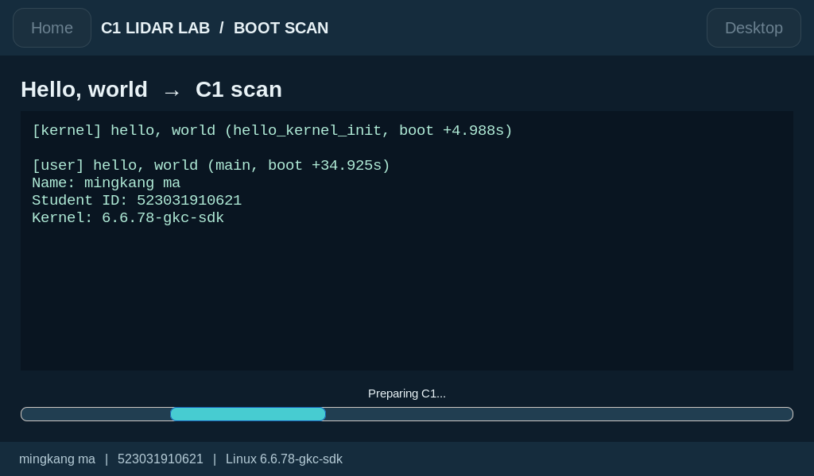
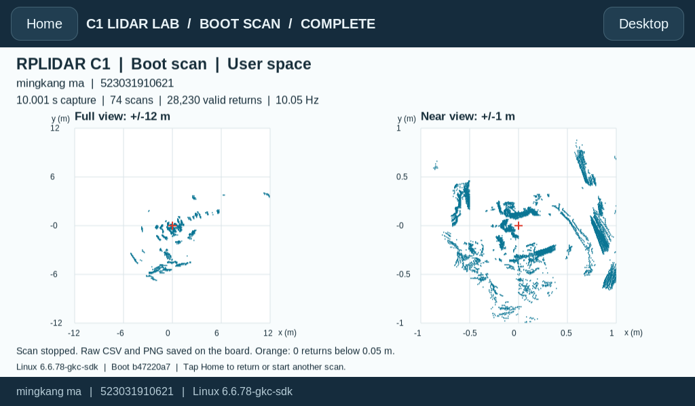
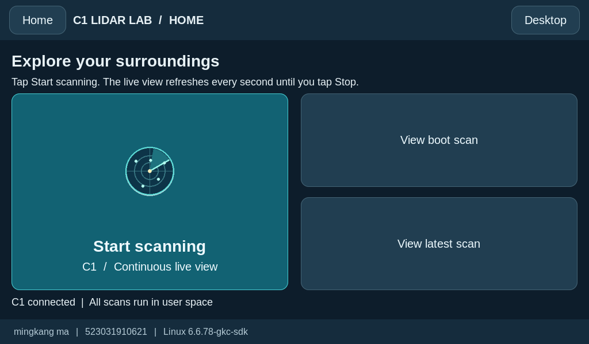
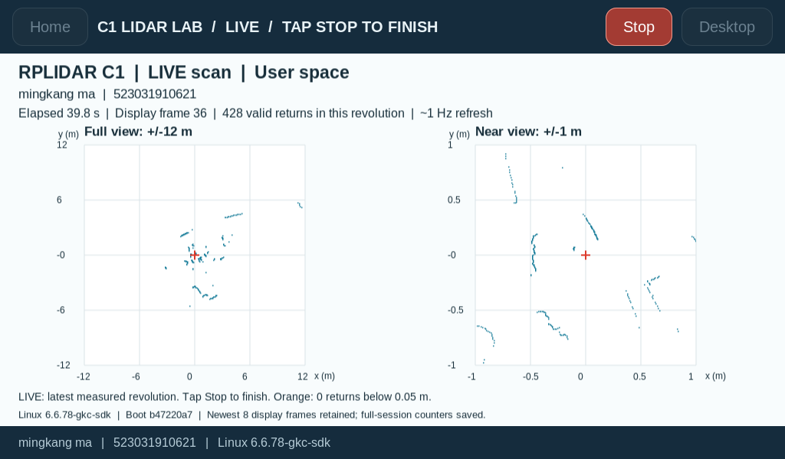
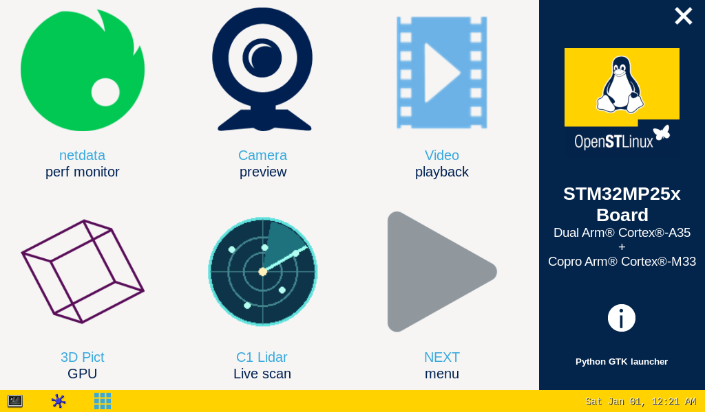

**English** | [简体中文](README.zh-CN.md)

# STM32MP257F-DK: Linux, Hello World and C1 LiDAR

```text
/**************** (C) COPYRIGHT 2026 ShangHai Jiao Tong University ****************
File Name   : readme.txt / README.md
Version     : V1.1
Date        : 2026-11-10
Project     : [PROJECT NAME TO BE FILLED IN]
Group No.   : [GROUP NUMBER TO BE FILLED IN]
Author      : [Name 1] [Name 2] [Name 3] [Name 4] [Name 5] [Name 6]
AI co-author: Codex (OpenAI)
Description : Rebuild and boot Linux; print Hello World in kernel and user space;
              load the C1 USB serial driver; acquire, display and control LiDAR
              data through a touchscreen application.
********************************************************************************/
```

The author order is intentionally unassigned. All members must confirm the final roster and order before submission. The executable currently displays the demonstration identity **mingkang ma / 523031910621**; this is separate from the group roster.

**AI contribution disclosure:** Codex (OpenAI) contributed to the environment setup, build and deployment scripts, kernel and user-space greetings, C1 acquisition and touchscreen application, debugging, automated checks, and English documentation under the experimenter's direction. The human experimenter connected the hardware, performed the requested physical power cycles, observed the display and touch behavior, and confirmed the experimental results. Codex is credited as an AI co-author and technical contributor; the student member roster and order remain reserved for the group.

This report covers work **after the board was flashed**. The tested release is OpenSTLinux **v25.06.11**, with the self-built kernel **6.6.78-gkc-sdk**. The kernel source, SDK, device trees and modules are supplied as a matched set.

**Repository:** [drxiaoma1/stm32mp257f-edge-ai-lab](https://github.com/drxiaoma1/stm32mp257f-edge-ai-lab) (personal account; public). Teachers and group members can view the source and download release attachments without a repository invitation.

**Submission binaries:** [v1.1-final release](https://github.com/drxiaoma1/stm32mp257f-edge-ai-lab/releases/tag/v1.1-final). Download `STM32MP257F-Final-Submission.zip`, extract it, then run `sha256sum -c SHA256SUMS` in the extracted directory. The repository and release ZIP both contain the final source, evidence, compiled kernel, executables, modules and board installers. The release also supplies the standalone `Image`, `Image.gz`, and their checksum list.

**Start with the [submission checklist](SUBMISSION-CHECKLIST.md).** It maps all five assessment requirements to the exact submitted files and final evidence. `artifacts/` contains the required binaries directly; `packages/` contains matching installers. This tree documents one complete implementation: kernel greeting → user greeting → automatic 10-second scan → touchscreen-controlled continuous scanning.

## 1. Environment is required as below

| Component | Tested setup / requirement |
|---|---|
| Board | ST STM32MP257F-DK, Cortex-A35, AArch64 |
| Board OS | OpenSTLinux Weston 5.0.8, Yocto Scarthgap, v25.06.11 |
| Kernel | Self-built Linux 6.6.78-gkc-sdk; official SDK GCC 13.3.0 |
| Display | HDMI display, active mode 1024 × 600; WaveShare WS170120 USB touchscreen |
| LiDAR | SLAMTEC RPLIDAR C1M1, model 0x41; firmware 1.02; USB CP210x adapter |
| Serial link | 460800 baud, 8N1; `/dev/c1lidar` points to `/dev/ttyUSB0` on this board |
| Linux build host | Ubuntu 24.04 ARM64 VM on Apple Silicon macOS (tested) |
| Windows alternative | x86_64 Ubuntu VM or WSL2, with the x86_64-host OpenSTLinux SDK; target remains AArch64 |
| Toolchain | STM32MP2 Developer Package 6.1.0 / OpenSTLinux SDK v25.06.11 |
| Board graphics | Weston, Python 3, PyGObject/GTK 3 and Cairo already supplied by this image |

### Host-specific preparation

- **macOS / Apple Silicon:** run ARM64 Ubuntu in Lima or another Linux VM. Install the **MP2-DEV-Arm** SDK inside Linux. Keep the SDK and kernel build on the VM's Linux filesystem. The tested VM has 6 CPUs and 6 GB RAM. macOS itself does not run the Linux SDK compiler.
- **Windows / Intel or AMD:** use x86_64 Ubuntu and **MP2-DEV-x86**. For WSL2, work under `~/edge-ai-official`, not `/mnt/c`. For a VM, keep the SDK and build on its ext4 disk. Transfer final files from Windows PowerShell if the USB network adapter is attached to Windows. The Windows procedure is provided for reproduction; this complete revision was tested on the ARM64 Linux VM, not on a Windows machine.
- Keep the ST-LINK console available at **115200 8N1**. Connect **CN15 USB OTG** to the host for network transfer. Connect the C1 adapter to a **USB HOST** port. HDMI carries video; the display's USB touch/power connection is also required for touch input.
- In this setup the board USB address is `192.168.7.1`. Confirm it over the serial console with `ip -br address`. Test `ssh root@192.168.7.1` from the host. Use the credentials configured on your own image. The tested image has Dropbear; use `scp -O` for its legacy SCP protocol.

### Common Ubuntu dependencies

Run in Ubuntu, not on the board:

```sh
sudo apt-get update
sudo apt-get install -y build-essential bc bison flex libssl-dev libelf-dev \
  libncurses-dev libyaml-dev u-boot-tools dwarves device-tree-compiler kmod \
  gawk diffstat chrpath socat texinfo python3 python3-pip python3-pexpect \
  git rsync cpio file wget curl xz-utils unzip minicom
export PROJECT="$HOME/stm32mp257f-edge-ai-lab"
export LAB="$HOME/edge-ai-official"
mkdir -p "$LAB"/{downloads,src,build}
```

Clone the repository into `$PROJECT`, or place the extracted source tree there. The binary submission ZIP also contains the required project sources; no Git account is required to inspect that local copy.

Obtain the matching official SDK from [ST STM32MP2 Developer Package](https://www.st.com/en/embedded-software/stm32mp2dev.html#get-software), or reuse the group's previously prepared offline SDK package. Select **6.1.0**, the correct Linux **host** architecture, and accept the ST license yourself. A FLASH package is a prebuilt board image; it is not the SDK. SDK installers and personal download tokens are not published in this repository.

```sh
# Substitute the exact downloaded archive name; extract only one host SDK here.
tar -xf /path/to/SDK-HOST-stm32mp2-openstlinux-6.6-yocto-scarthgap-mpu-v25.06.11.tar.gz -C "$LAB/downloads"
find "$LAB/downloads" -name '*toolchain*.sh'
# Substitute the one installer shown by the preceding command.
bash /path/to/the/toolchain-installer.sh -y -d "$LAB/SDK"
source "$LAB/SDK/environment-setup-cortexa35-ostl-linux"
printf '%s\n' "$CROSS_COMPILE" "$CC"
$CC --version
```

Expected: `aarch64-ostl-linux-`, GCC 13.3.0, Cortex-A35 flags and a target `--sysroot`. Source this environment again in every new build shell. An Ubuntu generic cross-compiler is not a substitute for the official SDK in this procedure.

## 2. Development tasks are added as the following

1. Configure a Linux build environment and install the official OpenSTLinux SDK.
2. Configure, compile and boot the Linux kernel; submit `Image` and `Image.gz`.
3. Build a kernel greeting module and a user-space Hello World executable with Makefile.
4. Load the C1 adapter's `usbserial.ko` and `cp210x.ko` into the rebuilt kernel using `insmod`.
5. Build the C1 acquisition programs and a touchscreen application; verify automatic and continuous manual operation.

## How to use

```text
STEP 0 - Prepare Ubuntu, the official SDK, serial console and USB networking.
STEP 1 - Configure, compile and deploy the matching kernel and GPU module.
STEP 2 - Build the kernel greeting and the user-space Hello World program.
STEP 3 - Install and verify the C1 USB serial kernel modules.
STEP 4 - Build and install the user-space LiDAR programs and touch application.
STEP 5 - Reboot, inspect both greetings, view the automatic scan, then test live scanning.
```

For a board **already running 6.6.78-gkc-sdk**, the short deployment path is to transfer the submission ZIP, extract it on the board, then run `sh install-board.sh` as root. It verifies the supplied files and installs the two greeting stages, C1 programs, launcher and boot services. Reboot afterward. Keep reading for the equivalent build steps and implementation details.

## STEP 1 — Compilation of kernel

### 1. Pre-requisite

Use the SDK and Ubuntu dependencies above. Keep the kernel, external device tree and graphics module versions matched. The tested source is ST's `v6.6-stm32mp-r2`, which already includes ST patches; do not apply the same patches again.

### 2. Initialize cross-compilation via SDK

```sh
source "$LAB/SDK/environment-setup-cortexa35-ostl-linux"
test "$CROSS_COMPILE" = aarch64-ostl-linux-
test "$ARCH" = arm64
```

### 3. Prepare kernel source code

```sh
cd "$LAB/downloads"
curl -fL https://api.github.com/repos/STMicroelectronics/linux/tarball/v6.6-stm32mp-r2 -o linux-r2.tar.gz
curl -fL https://api.github.com/repos/STMicroelectronics/meta-st-stm32mp/tarball/openstlinux-6.6-yocto-scarthgap-mpu-v25.06.11 -o meta-st.tar.gz
curl -fL https://api.github.com/repos/STMicroelectronics/dt-stm32mp/tarball/ea2e971efac93f4644ceede7b997081ed49780ad -o external-dt.tar.gz
curl -fL https://api.github.com/repos/STMicroelectronics/gcnano-binaries/tarball/7c181cacf89f918039e64934fdc33fe817a052cd -o gcnano.tar.gz
mkdir -p "$LAB/src"/{linux,meta-st,external-dt,gcnano}
tar -xf linux-r2.tar.gz -C "$LAB/src/linux" --strip-components=1
tar -xf meta-st.tar.gz -C "$LAB/src/meta-st" --strip-components=1
tar -xf external-dt.tar.gz -C "$LAB/src/external-dt" --strip-components=1
tar -xf gcnano.tar.gz -C "$LAB/src/gcnano" --strip-components=1
```

Extract into empty directories on the first run. The group's original source archives may be reused offline. Alternatively, extract the matching ST SOURCES package and follow its own README; do not mix the r3 sample sources with this r2 build.

### 4. Manage kernel source code

The tested method uses official source snapshots without Git metadata. Optional Git users should check out `v6.6-stm32mp-r2` from ST's Linux repository. Preserve `.config`, source references, build logs and `Module.symvers`. If using a Git checkout, create empty `.scmversion` files in the source and output directories to suppress an unintended SCM suffix.

### 5. Configure kernel source code

[`scripts/build-sdk-kernel.sh`](scripts/build-sdk-kernel.sh) performs the following sequence:

- `defconfig` plus ST fragment-01 and fragment-02 from the kernel tree.
- fragment-03-systemd and fragment-04-modules from the matching meta-st layer.
- `CONFIG_LOCALVERSION="-gkc-sdk"`, with `CONFIG_LOCALVERSION_AUTO` disabled.
- `olddefconfig`, followed by the out-of-tree build in `$LAB/build/kernel`.

The submitted `.config` includes `CONFIG_USB_SERIAL=m` and `CONFIG_USB_SERIAL_CP210X=m`. Confirm these before compiling:

```sh
grep -E '^CONFIG_(LOCALVERSION|USB_SERIAL|USB_SERIAL_CP210X)=' "$LAB/build/kernel/.config"
```

The script creates the configuration when run in the next step; the command above is an inspection command after configuration exists.

### 6. Compile kernel source code

```sh
LAB_ROOT="$LAB" bash "$PROJECT/scripts/build-sdk-kernel.sh" 2>&1 | tee "$LAB/kernel-build.log"
LAB_ROOT="$LAB" bash "$PROJECT/scripts/build-sdk-gpu.sh" 2>&1 | tee "$LAB/gpu-build.log"
```

The kernel script builds `Image.gz`, `vmlinux`, modules and device trees with `KBUILD_EXTDTS=$LAB/src/external-dt/stm32mp2/a35-td/linux`. Building `Image.gz` also generates the uncompressed ARM64 `Image`. It installs stripped modules into `build/kernel/install_artifact`. The GPU script builds the matching `galcore.ko`; it is needed by the existing Weston graphics stack.

```sh
make -s -C "$LAB/src/linux" O="$LAB/build/kernel" kernelrelease
file "$LAB/build/kernel/arch/arm64/boot/Image"
sha256sum "$LAB/build/kernel/arch/arm64/boot/Image" "$LAB/build/kernel/arch/arm64/boot/Image.gz"
```

Expected kernel release: `6.6.78-gkc-sdk`. Submitted artifacts are in `artifacts/kernel/`: `Image`, `Image.gz`, `.config`, `Module.symvers` and the matching board DTBs. Build hashes may differ after a new build; compare the files from **your own build** with the deployed copies.

### 7. Update software on board

For the already configured project board, the submitted kernel is already installed. Its `/boot/Image-6.6.78-gkc-sdk.gz` hash matches the supplied `Image.gz`; no additional flashing is necessary.

For a board on the matching factory `6.6.78` baseline, `packages/gkc-kernel-6.6.78.tar.gz` supplies the final kernel, DTBs and complete matching module tree, including `galcore.ko`. This package installs only the kernel; STEP 4 installs the complete application. Transfer from either macOS Terminal or Windows PowerShell:

```sh
scp -O packages/gkc-kernel-6.6.78.tar.gz root@192.168.7.1:/home/root/
ssh root@192.168.7.1
```

Then, on the board:

```sh
cd /home/root
tar -xzf gkc-kernel-6.6.78.tar.gz
python3 gkc-kernel/scripts/deploy-sdk-board.py /home/root/gkc-kernel
python3 gkc-kernel/scripts/deploy-sdk-board.py /home/root/gkc-kernel --apply
sync
reboot
```

The first invocation validates without installing. The second saves a backup, installs the image, DTBs and matching modules, and adds a separate boot entry while retaining the factory entry. It deliberately refuses to redeploy onto an already running `6.6.78-gkc-sdk` system. After reboot, run STEP 4 to install the final greeting and C1 application.

To deploy a newly rebuilt kernel, copy the kernel package and replace its `kernel/` directory with your complete `install_artifact/` (including the rebuilt GPU module), remove module `build`/`source` symlinks, and regenerate its `SHA256SUMS`. Use the same validator and installer on the matching baseline. Do not replace only the image while keeping incompatible modules.

### 8. Update Starter Package with kernel compilation outputs

This project deployed directly to the board and preserved the original FLASH package for recovery; **a newly repacked complete FLASH image is not a claimed result**. To prepare a separate distribution image, mount copies of the Starter Package's bootfs/rootfs under Ubuntu, copy the new image/DTBs into bootfs and the complete matching modules into rootfs, then unmount cleanly. Follow the version-matched ST package README and FlashLayout. Repacking firmware/rootfs is not required to reproduce the submitted running kernel.

## STEP 2 — Hello World user program and kernel greeting

### Build with the official SDK

Edit `STUDENT_NAME` and `STUDENT_ID` in [`dual-hello/user/hello_world.c`](dual-hello/user/hello_world.c) for a different demonstration identity. Preserve the `Name:` and `Student ID:` field labels; the GUI reads them.

```sh
source "$LAB/SDK/environment-setup-cortexa35-ostl-linux"
make -C "$PROJECT/dual-hello/user" clean all
file "$PROJECT/dual-hello/user/hello_world"
SDK_ENV="$LAB/SDK/environment-setup-cortexa35-ostl-linux" \
KERNEL_SOURCE="$LAB/src/linux" KERNEL_BUILD="$LAB/build/kernel" \
  bash "$PROJECT/dual-hello/build.sh"
python3 "$PROJECT/dual-hello/package.py"
```

The Makefile uses the SDK's `CC`, `CFLAGS` and `LDFLAGS`; its recipes contain real TAB characters. `dual-hello/build.sh` additionally builds `hello_kernel.ko` against the completed kernel build and `Module.symvers`. The supplied `artifacts/hello/hello_world` is an AArch64 ELF executable, accompanied by its exact source and Makefile.

### Where the two prints occur

- **Kernel space:** `hello_kernel_init()` in [`dual-hello/kernel/hello_kernel.c`](dual-hello/kernel/hello_kernel.c) executes `pr_info("%s", greeting)`. It runs when `hello_kernel.ko` is loaded during system startup. This is a loadable kernel module, not code built directly into `Image`, and it runs after PID 1 has started loading modules.
- **User space:** `main()` in [`dual-hello/user/hello_world.c`](dual-hello/user/hello_world.c) executes `printf("%s\n", user_message)`. The GUI starts this ordinary process as user `weston` (UID 1000), captures its output and displays it.
- `/dev/hello_kernel` lets the GUI read back the **earlier** kernel greeting. Displaying that saved text does not execute a second kernel `printk`. Manual scans do not rerun Hello World.

Verification on the tested software boot:

```text
[kernel] hello, world (hello_kernel_init, boot +4.988s)
[user] hello, world (main, boot +34.925s)
Name: mingkang ma
Student ID: 523031910621
Kernel: 6.6.78-gkc-sdk
```

The driver print is in the kernel journal. The user message appears in the application's stdout journal and in BusyBox `/var/log/messages`; this board does not retain that syslog entry under `journalctl -t hello_user`. Verify with `dual-hello/board/verify.sh`, which checks both contexts, boot ID, identity and ordering.

## STEP 3 — C1 driver modules: insmod into Linux

The **kernel driver** for the USB adapter is `cp210x`, depending on `usbserial`. The **SLAMTEC SDK is a user-space library**, linked into the acquisition executables. The SDK is not a `.ko` file and cannot be loaded with `insmod`.

The kernel build produces:

```text
build/kernel/drivers/usb/serial/usbserial.ko
build/kernel/drivers/usb/serial/cp210x.ko
```

Matching copies are supplied in `artifacts/drivers/`. On the board, stop acquisition first. The following unload/reload demonstration was actually tested on this board; do not unload these modules while another serial application is using them:

```sh
c1ctl stop
rmmod cp210x
rmmod usbserial
insmod /lib/modules/$(uname -r)/kernel/drivers/usb/serial/usbserial.ko
insmod /lib/modules/$(uname -r)/kernel/drivers/usb/serial/cp210x.ko
udevadm settle
lsmod | grep -E 'cp210x|usbserial'
ls -l /dev/c1lidar
modinfo -F vermagic cp210x
dmesg | tail -12
```

Expected: CP210x attaches to `ttyUSB0`, `/dev/c1lidar -> ttyUSB0`, and vermagic begins with `6.6.78-gkc-sdk`. On a fresh installation where these modules are not loaded, skip the two `rmmod` commands. Boot loading uses `/etc/modules-load.d/c1-lidar.conf` with `cp210x`; `modprobe` then resolves dependencies automatically.

The supplied udev rule selects this adapter's serial number. For another group's adapter, find its serial using `udevadm info --attribute-walk --name=/dev/ttyUSB0`, and run the installer with `C1_USB_SERIAL=YOUR_ADAPTER_SERIAL`. Do not change the baud rate from 460800.

## STEP 4 — LiDAR acquisition application

### Build the SDK and applications

The official RPLIDAR SDK 2.1.0 source is included under `lidar-lab/vendor/rplidar_sdk`, pinned to commit `99478e5fb90de3b4a6db0080acacd373f8b36869`. Its original license is retained.

```sh
SDK_ENV="$LAB/SDK/environment-setup-cortexa35-ostl-linux" \
  bash "$PROJECT/lidar-lab/scripts/build.sh"
# For later application-only changes, reuse the built SDK static library:
source "$LAB/SDK/environment-setup-cortexa35-ostl-linux"
make -C "$PROJECT/lidar-lab" all
```

- `c1_capture`: bounded collection, including the automatic 10-second scan. Saves full CSV data, metadata and a log.
- `c1_live`: continuous collection until SIGINT/SIGTERM. Captures at the C1's native rotation rate and publishes the newest measured revolution about once per second.
- `c1_demo.py`: touchscreen controls, startup sequencing, single-instance application and per-boot automatic-scan state.
- `render_pointcloud.py`: renders real coordinates using Cairo; no cloud service or simulated points.

### Install the final application

In the extracted submission directory on the board:

```sh
uname -r                         # must be 6.6.78-gkc-sdk
sha256sum -c SHA256SUMS
sh install-board.sh
sync
reboot
```

To package source changes yourself, rebuild both applications, copy `lidar-lab/output/c1_capture` and `c1_live` plus the matching `cp210x.ko` and `usbserial.ko` into `lidar-lab/boot-demo/output/`, then run `python3 lidar-lab/boot-demo/package.py`. Rebuild/package `dual-hello` separately after changing its C sources. Replace the corresponding deployment archives in `packages/` and regenerate the submission checksum manifest before installation.

### Screen operation

1. **Startup:** the kernel prints its greeting; after Weston starts, the user program prints its greeting. The screen shows both messages and the student's identity while one automatic scan runs.
2. **Automatic scan:** acquisition lasts **10 seconds**, then stops and shows the point cloud. Sensor initialization and image generation add time; the measured Hello-to-image sequence was about **14.9 seconds**, not exactly 10 seconds wall-clock.
3. **Home:** returns to the application home page without starting another scan. `View boot scan` and `View latest scan` reopen saved results.
4. **Start scanning:** starts continuous user-space acquisition. The plot refreshes at approximately **1 Hz** and continues beyond 10 seconds.
5. **Stop:** sends SIGINT to the acquisition process. The application sends the SDK stop command, closes the serial connection and preserves the final image. Home becomes available again.
6. **Desktop:** returns to the ST launcher. Its **C1 Lidar / Live scan** icon launches continuous acquisition directly. The same application instance is reused.

During acquisition, Home/Desktop are disabled to prevent leaving a hidden scan running. Repeated launch requests do not create simultaneous collectors. A process lock also prevents the automatic and manual programs from owning the serial port together. Restarting the UI in the same boot opens Home and does not repeat the automatic scan or the user greeting.

### USB unplug/replug behavior

`insmod` loads and registers a driver in the kernel. Removing the USB adapter removes that device instance; it does not normally unload `cp210x` or `usbserial`. Reinserting the same adapter should trigger automatic USB matching/probing and recreate `/dev/c1lidar` through the serial-number-specific udev rule. The underlying `ttyUSB` number may change without changing this symlink.

An existing acquisition process holds the old serial connection and does **not** seamlessly resume after unplugging. If it reports an error, reconnect C1, return Home and tap **Start scanning**, or run `c1ctl scan` after the old scan has exited. This opens the device again; a second `insmod` is normally unnecessary. A replacement adapter with a different serial number requires updating the udev rule. Module auto-binding is expected from the driver/udev configuration; unplug/replug recovery was not physically tested for this submission.

### Command-line operation

```sh
c1ctl status        # kernel, driver and latest completed result
c1ctl home          # show the touch application's home page
c1ctl scan          # start continuous live scanning in the app
c1ctl result        # location of the latest completed result
c1ctl stop          # stop the entire application and its acquisition process
c1ctl start         # start/reopen the service; no repeated boot scan in the same boot
```

For a standalone terminal experiment, stop the GUI first and use a new output path:

```sh
c1ctl stop
mkdir -p /home/root/c1-terminal-run
/opt/c1-lab/c1_capture /dev/c1lidar --seconds 10 /home/root/c1-terminal-run/scan.csv
mkdir -p /home/root/c1-terminal-live
/opt/c1-lab/c1_live /dev/c1lidar /home/root/c1-terminal-live
# Press Ctrl+C to stop the continuous terminal program.
c1ctl start
```

### Data and interpretation

Automatic results: `/var/lib/c1-lab/boots/<boot-id>/automatic/`. Manual sessions: `/var/lib/c1-lab/runs/<boot-prefix>-manual-<id>/`. `latest` points to the most recent **completed** result.

- `hello.txt`: original greeting output for that boot.
- `capture.log`: SDK identification, health, progress and termination.
- `scan.csv`, `scan.csv.json`, `pointcloud.png`, `state.json`: completed result.
- During manual operation, `live.json` identifies the newest frame; `frames/` retains the last **8 displayed revolutions** to bound disk usage.
- `session.json` records the continuous session duration, total captured rotations/samples/valid points and stop status. The final manual CSV/PNG represents the **last displayed revolution**, not all points accumulated over the whole session.

The C1 is a **2D** scanner. A valid node has positive distance and quality. Conversion is `distance_m = dist_mm_q2 / 4000`, `angle_deg = angle_z_q14 * 90 / 16384`, `x = d cos(angle)`, `y = -d sin(angle)`. The minus sign converts the SDK's clockwise angles to the plotted coordinates. Very short returns are marked separately; the plots are measured sensor data, not a 3D reconstruction or SLAM map.

## STEP 5 — Results and submission checklist

| Check | Recorded result |
|---|---|
| Rebuilt kernel | `6.6.78-gkc-sdk` running; submitted compressed image matches `/boot/Image-6.6.78-gkc-sdk.gz` |
| Kernel greeting | One kernel journal print at boot +4.994 s; source timestamp +4.988 s |
| User greeting | One stdout greeting at boot +34.928 s; process PID 1532, GUI UID 1000 |
| `insmod` | Both modules loaded successfully; C1 reattached to `/dev/ttyUSB0` |
| Automatic scan after software reboot | 10.000975 s, 74 rotations, 28,230 valid points, stop successful |
| Continuous manual scan | 189.800798 s, 1,874 rotations, 798,803 valid points; 177 displayed frames; stopped by the Stop control |
| Touch navigation | Start, Stop and Home tested through evdev; the experimenter subsequently confirmed successful hands-on operation |
| UI restart | Reopens Home without repeating the boot scan or greeting |

Evidence uses boot IDs and monotonic uptime because the board's wall clock is not synchronized. The verified software-boot ID is `b47220a7-a6c4-4049-a817-27606b6d28a8`. This revision has a **software-reboot** test; a new physical power-cycle test has not yet been performed.











The screenshots above were captured from the board's actual HDMI output. `evidence/` also contains raw logs, automatic CSV/JSON and continuous-session statistics. Temporary Weston screenshot permission was enabled for evidence capture; it is not required for normal scanning.

### Files to submit

| Requirement | File / directory in the release ZIP |
|---|---|
| English report | `README.md`, `readme.txt` |
| Kernel image | `artifacts/kernel/Image`, `artifacts/kernel/Image.gz` |
| Kernel configuration / symbols / DTBs | `artifacts/kernel/` |
| Hello source, Makefile, executable | `artifacts/hello/` and `dual-hello/user/` |
| Kernel greeting source / module | `dual-hello/kernel/`, `artifacts/drivers/hello_kernel.ko` |
| C1 USB serial modules | `artifacts/drivers/usbserial.ko`, `cp210x.ko` |
| Matching display driver / complete module tree | `artifacts/drivers/galcore.ko`, `packages/gkc-kernel-6.6.78.tar.gz` |
| C1 acquisition source and binaries | `lidar-lab/src/`, `lidar-lab/Makefile`, `artifacts/lidar/` |
| Touch UI and startup services | `lidar-lab/boot-demo/board/`, `dual-hello/board/` |
| Deployment archives | `packages/` |
| Observed operation and output | `evidence/`, `SHA256SUMS` |

Fill in the project name, group number and confirmed member order before handing in the report. The owner has made the repository public for teacher review. Share the repository and release links with the teacher, and submit the ZIP through the course's submission channel if required. The source, release attachments, displayed name, student ID and experiment evidence are publicly accessible.

### Invalid returns and transport errors

An all-zero-distance revolution is treated as an empty measurement. Continuous acquisition proceeds and the plot explicitly shows that no valid returns are available; stale points are not shown as fresh data. Actual transport failures stop the session and display an error. The regression checks in `lidar-lab/tests/` use test-only synthetic input, never data presented as measured sensor output. The final hardware run lasted 189.8 seconds and stopped on request.

### Check the supplied files

```sh
sha256sum -c SHA256SUMS
python3 scripts/verify-submission.py
```

The verifier checks required files, SHA-256 hashes, AArch64 executable/module formats, kernel/module version agreement, image compression, nested installer contents, and consistency with recorded final hardware hashes. See [SUBMISSION-CHECKLIST.md](SUBMISSION-CHECKLIST.md) and [SUBMISSION-AUDIT.json](SUBMISSION-AUDIT.json) for the file inventory and audit results. These are package checks, not a new hardware run. Only the project name, group number and confirmed student author order remain to be filled in.

## References and provenance

- [ST Developer Package](https://www.st.com/en/embedded-software/stm32mp2dev.html) — official SDK and release family.
- [ST Linux v6.6-stm32mp-r2](https://github.com/STMicroelectronics/linux/tree/v6.6-stm32mp-r2) — kernel source.
- [Pinned RPLIDAR SDK source](https://github.com/Slamtec/rplidar_sdk/tree/99478e5fb90de3b4a6db0080acacd373f8b36869) — C1 protocol and acquisition API.
- `scripts/`, `.config`, build logs and checksums record the actual configuration and build; upstream source snapshots and license notices remain associated with their respective components.

```text
******************* END OF FILE *******************
```
