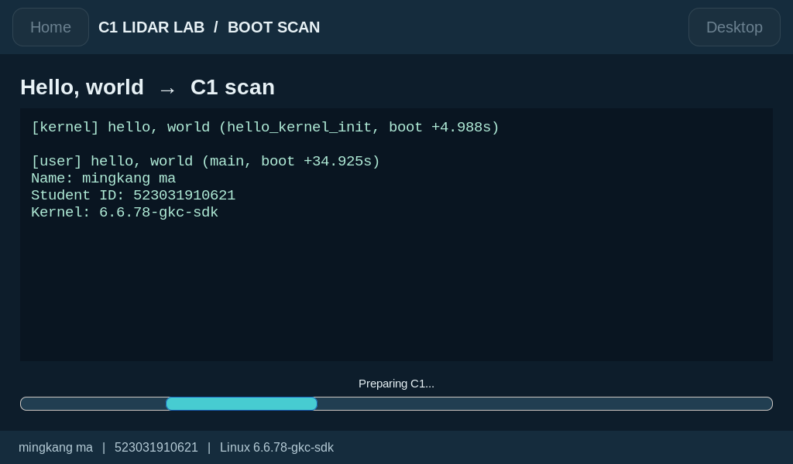
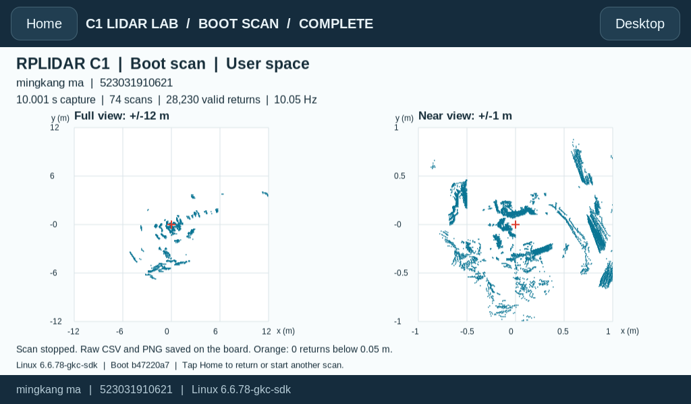
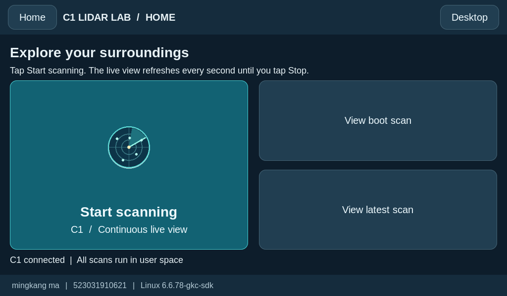
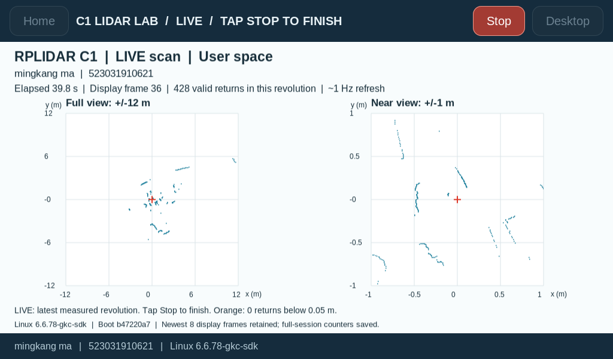
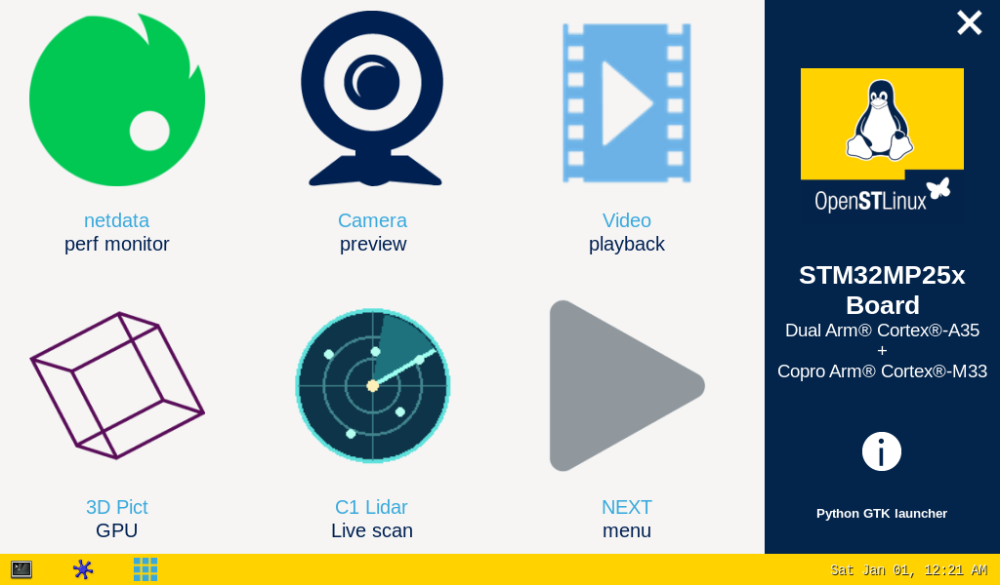

[English](README.md) | **简体中文**

# STM32MP257F-DK：Linux、Hello World 与 C1 激光雷达实验

本页是英文 README 的中文版，供组员阅读与复现。**英文版仍为正式考核提交报告**，中英文版本使用相同的代码、命令、实验数据和截图。

```text
/**************** (C) COPYRIGHT 2026 ShangHai Jiao Tong University ****************
文件名称    : README.zh-CN.md（中文版）
版本        : V1.0
日期        : 2026-11-03
项目名称    : [待填写]
项目组号    : [待填写]
作者        : [姓名 1] [姓名 2] [姓名 3] [姓名 4] [姓名 5] [姓名 6]
AI 共同作者 : Codex (OpenAI)
项目说明    : 重新编译并启动 Linux；在内核空间和用户空间分别打印 Hello World；
              加载 C1 的 USB 串口驱动；通过触摸屏程序采集、显示和控制雷达数据。
********************************************************************************/
```

组员姓名与排列顺序暂未确定，提交前需由全体组员确认。当前程序中的演示身份为 **mingkang ma / 523031910621**，与项目组作者名单分开填写。

**AI 贡献说明：** Codex（OpenAI）在实验者指导下，参与了环境配置、编译与部署脚本、内核和用户空间问候程序、C1 数据采集与触屏程序、问题排查、自动检查及英文文档编写。硬件接线、要求进行的实际断电上电、屏幕与触摸效果观察以及实验结果确认由人类实验者完成。Codex 作为 AI 共同作者和技术贡献者署名；学生组员名单与排序由项目组自行确定。

本报告记录的是**板卡刷机完成之后**的工作。已测试的系统版本为 OpenSTLinux **v25.06.11**，自行编译的内核版本为 **6.6.78-gkc-sdk**。老师的样例以 `6.6.116 / r3` 为例，本项目沿用已经验证的 `6.6.78 / r2` 源码、SDK、设备树和模块，保证版本配套。

**项目仓库：** [drxiaoma1/stm32mp257f-edge-ai-lab](https://github.com/drxiaoma1/stm32mp257f-edge-ai-lab)，属于个人账号，已公开。老师和组员无需仓库邀请即可查看源码、下载发布附件。

**编译产物与提交包：** [v1.0-midterm 发布页](https://github.com/drxiaoma1/stm32mp257f-edge-ai-lab/releases/tag/v1.0-midterm)。下载并解压 `STM32MP257F-Midterm-Submission.zip`，在解压后的目录运行 `sha256sum -c SHA256SUMS` 校验文件。Git 仓库保存源码与实验记录；发布 ZIP 包含编译好的内核、可执行文件、模块和板端安装程序。发布页也单独提供 `Image`、`Image.gz` 及其校验清单。

## 1. 实验环境

| 项目 | 已测试配置 / 要求 |
|---|---|
| 开发板 | ST STM32MP257F-DK，Cortex-A35，AArch64 |
| 板端系统 | OpenSTLinux Weston 5.0.8，Yocto Scarthgap，v25.06.11 |
| 内核 | 自行编译的 Linux 6.6.78-gkc-sdk；官方 SDK GCC 13.3.0 |
| 显示设备 | HDMI 显示屏，实际显示模式 1024 × 600；WaveShare WS170120 USB 触摸屏 |
| 激光雷达 | 思岚 SLAMTEC RPLIDAR C1M1，型号 0x41；固件 1.02；USB CP210x 转接器 |
| 串口参数 | 460800 波特率，8N1；本板 `/dev/c1lidar` 指向 `/dev/ttyUSB0` |
| Linux 编译主机 | Apple Silicon macOS 上的 Ubuntu 24.04 ARM64 虚拟机，已实测 |
| Windows 方案 | x86_64 Ubuntu 虚拟机或 WSL2，使用 x86_64 主机版 OpenSTLinux SDK；目标架构仍为 AArch64 |
| 工具链 | STM32MP2 Developer Package 6.1.0 / OpenSTLinux SDK v25.06.11 |
| 板端图形环境 | 镜像已提供 Weston、Python 3、PyGObject/GTK 3 和 Cairo |

### macOS 与 Windows 的准备差异

- **macOS / Apple Silicon：** 在 Lima 或其他 Linux 虚拟机中运行 ARM64 Ubuntu，在 Linux 内安装 **MP2-DEV-Arm** SDK。SDK 和内核编译目录放在虚拟机的 Linux 文件系统中。实测虚拟机分配了 6 个 CPU 和 6 GB 内存。macOS 本身不能直接运行该 Linux SDK 编译器。
- **Windows / Intel 或 AMD：** 使用 x86_64 Ubuntu 和 **MP2-DEV-x86**。WSL2 中建议在 `~/edge-ai-official` 下工作，不放在 `/mnt/c`；虚拟机则使用其 ext4 磁盘。若板卡 USB 网卡连接到 Windows，可用 Windows PowerShell 传输最终文件。此方案供复现参考；本次完整版本是在 ARM64 Linux 虚拟机上验证的，未在 Windows 机器上完成全流程实测。
- 保留 ST-LINK 串口控制台，参数为 **115200 8N1**。将 **CN15 USB OTG** 接到主机以传输文件，将 C1 转接器接到板卡 **USB HOST** 接口。HDMI 传输视频，触摸功能还需连接屏幕的 USB 触摸/供电线。
- 本实验的板卡 USB 网络地址为 `192.168.7.1`。可通过串口运行 `ip -br address` 确认，再在主机测试 `ssh root@192.168.7.1`。使用自己镜像所配置的登录凭据。本镜像使用 Dropbear，文件传输使用 `scp -O` 兼容旧式 SCP 协议。

### Ubuntu 通用依赖

以下命令在 Ubuntu 编译主机中运行，**不是在板卡上运行**：

```sh
sudo apt-get update
sudo apt-get install -y build-essential bc bison flex libssl-dev libelf-dev \
  libncurses-dev libyaml-dev u-boot-tools dwarves device-tree-compiler kmod \
  gawk diffstat chrpath socat texinfo python3 python3-pip python3-pexpect \
  git rsync cpio file wget curl xz-utils unzip minicom
export PROJECT="$HOME/stm32mp257f-edge-ai-lab"
export LAB="$HOME/edge-ai-official"
mkdir -p "$LAB"/{downloads,src,build}
```

将仓库克隆到 `$PROJECT`，或将解压后的项目源码放在该目录。提交 ZIP 也包含所需项目源码，查看本地副本不需要 GitHub 账号。

从 [ST STM32MP2 Developer Package](https://www.st.com/en/embedded-software/stm32mp2dev.html#get-software) 获取配套的官方 SDK，或使用组内此前准备的离线 SDK 包。选择 **6.1.0** 及正确的 Linux **主机**架构，并自行接受 ST 许可。FLASH 包是预编译的板卡镜像，不是 SDK。本仓库不发布 SDK 安装包或个人下载令牌。

```sh
# Substitute the exact downloaded archive name; extract only one host SDK here.
tar -xf /path/to/SDK-HOST-stm32mp2-openstlinux-6.6-yocto-scarthgap-mpu-v25.06.11.tar.gz -C "$LAB/downloads"
find "$LAB/downloads" -name '*toolchain*.sh'
# Substitute the one installer shown by the preceding command.
bash /path/to/the/toolchain-installer.sh -y -d "$LAB/SDK"
source "$LAB/SDK/environment-setup-cortexa35-ostl-linux"
printf '%s\n' "$CROSS_COMPILE" "$CC"
$CC --version
```

将命令中的归档文件名、安装脚本路径替换为实际文件；同一解压目录只放一种主机架构的 SDK。预期看到 `aarch64-ostl-linux-`、GCC 13.3.0、Cortex-A35 参数及目标 `--sysroot`。每次打开新的编译终端，都需重新加载 SDK 环境。本实验流程使用官方 SDK，不使用 Ubuntu 通用交叉编译器替代。

## 2. 开发任务

1. 配置 Linux 编译环境，安装官方 OpenSTLinux SDK。
2. 配置、编译并启动 Linux 内核，提交 `Image` 和 `Image.gz`。
3. 编写内核问候模块与用户空间 Hello World 程序，使用 Makefile 编译。
4. 使用 `insmod` 将 C1 转接器所需的 `usbserial.ko`、`cp210x.ko` 加载到自行编译的内核中。
5. 编译 C1 数据采集程序和触摸屏应用，验证开机自动扫描与手动持续扫描。

## 使用顺序

```text
STEP 0 — 准备 Ubuntu、官方 SDK、串口控制台与 USB 网络。
STEP 1 — 配置、编译并部署配套内核与 GPU 模块。
STEP 2 — 编译内核问候模块和用户空间 Hello World 程序。
STEP 3 — 安装并验证 C1 的 USB 串口内核模块。
STEP 4 — 编译并安装用户空间雷达程序和触屏应用。
STEP 5 — 重启，检查两次问候和自动扫描，再测试手动持续扫描。
```

如果板卡**已经运行 6.6.78-gkc-sdk**，可采用简短安装流程：将提交 ZIP 传到板卡并解压，以 root 身份运行 `sh install-board.sh`，完成后重启。安装程序会校验文件，安装两阶段问候、C1 程序、桌面入口和启动服务。以下章节提供对应的完整编译步骤与实现说明。

## STEP 1 — 重新编译内核

### 1. 前提条件

使用上述 SDK 和 Ubuntu 依赖，保证内核、外部设备树和图形模块版本匹配。实测源码为 ST 的 `v6.6-stm32mp-r2`，其中已包含 ST 补丁，无需再次应用相同补丁。

### 2. 通过 SDK 初始化交叉编译环境

```sh
source "$LAB/SDK/environment-setup-cortexa35-ostl-linux"
test "$CROSS_COMPILE" = aarch64-ostl-linux-
test "$ARCH" = arm64
```

### 3. 准备内核源码

```sh
cd "$LAB/downloads"
curl -fL https://api.github.com/repos/STMicroelectronics/linux/tarball/v6.6-stm32mp-r2 -o linux-r2.tar.gz
curl -fL https://api.github.com/repos/STMicroelectronics/meta-st-stm32mp/tarball/openstlinux-6.6-yocto-scarthgap-mpu-v25.06.11 -o meta-st.tar.gz
curl -fL https://api.github.com/repos/STMicroelectronics/dt-stm32mp/tarball/ea2e971efac93f4644ceede7b997081ed49780ad -o external-dt.tar.gz
curl -fL https://api.github.com/repos/STMicroelectronics/gcnano-binaries/tarball/7c181cacf89f918039e64934fdc33fe817a052cd -o gcnano.tar.gz
mkdir -p "$LAB/src"/{linux,meta-st,external-dt,gcnano}
tar -xf linux-r2.tar.gz -C "$LAB/src/linux" --strip-components=1
tar -xf meta-st.tar.gz -C "$LAB/src/meta-st" --strip-components=1
tar -xf external-dt.tar.gz -C "$LAB/src/external-dt" --strip-components=1
tar -xf gcnano.tar.gz -C "$LAB/src/gcnano" --strip-components=1
```

首次运行时解压到空目录。也可离线使用组内原始源码归档，或解压版本匹配的 ST SOURCES 包并按照其随包 README 操作。不要将样例中的 r3 源码混入本次 r2 编译。

### 4. 管理内核源码

实测使用不含 Git 元数据的官方源码快照。若使用 Git 克隆 ST Linux 仓库，应检出 `v6.6-stm32mp-r2`。保留 `.config`、源码版本信息、编译日志和 `Module.symvers`。Git 工作副本可在源码目录与输出目录创建空 `.scmversion` 文件，避免出现额外的 SCM 版本后缀。

### 5. 配置内核

[`scripts/build-sdk-kernel.sh`](scripts/build-sdk-kernel.sh) 按以下顺序配置：

- 使用 `defconfig`，合入内核源码中的 ST fragment-01、fragment-02。
- 合入配套 meta-st 层中的 fragment-03-systemd、fragment-04-modules。
- 设置 `CONFIG_LOCALVERSION="-gkc-sdk"`，关闭 `CONFIG_LOCALVERSION_AUTO`。
- 执行 `olddefconfig`，随后在 `$LAB/build/kernel` 中进行独立输出目录编译。

提交的 `.config` 包含 `CONFIG_USB_SERIAL=m` 和 `CONFIG_USB_SERIAL_CP210X=m`，编译前应确认：

```sh
grep -E '^CONFIG_(LOCALVERSION|USB_SERIAL|USB_SERIAL_CP210X)=' "$LAB/build/kernel/.config"
```

下一步的脚本会生成配置；上述命令用于配置文件已经存在时的检查。

### 6. 编译内核

```sh
LAB_ROOT="$LAB" bash "$PROJECT/scripts/build-sdk-kernel.sh" 2>&1 | tee "$LAB/kernel-build.log"
LAB_ROOT="$LAB" bash "$PROJECT/scripts/build-sdk-gpu.sh" 2>&1 | tee "$LAB/gpu-build.log"
```

内核脚本通过 `KBUILD_EXTDTS=$LAB/src/external-dt/stm32mp2/a35-td/linux` 编译 `Image.gz`、`vmlinux`、模块和设备树。生成 `Image.gz` 时也会生成未压缩的 ARM64 `Image`。去除调试符号后的模块安装到 `build/kernel/install_artifact`。GPU 脚本编译配套 `galcore.ko`，供现有 Weston 图形环境使用。

```sh
make -s -C "$LAB/src/linux" O="$LAB/build/kernel" kernelrelease
file "$LAB/build/kernel/arch/arm64/boot/Image"
sha256sum "$LAB/build/kernel/arch/arm64/boot/Image" "$LAB/build/kernel/arch/arm64/boot/Image.gz"
```

预期内核版本为 `6.6.78-gkc-sdk`。提交文件位于 `artifacts/kernel/`，包括 `Image`、`Image.gz`、`.config`、`Module.symvers` 和配套板卡 DTB。重新编译后的哈希值可能不同，应比较**本次自己编译的文件**与部署到板卡的副本。

### 7. 更新板卡软件

已经配置好的项目板卡已安装提交版本的内核。其 `/boot/Image-6.6.78-gkc-sdk.gz` 与提供的 `Image.gz` 哈希一致，不需要再次刷机。

对于仍运行配套原厂 `6.6.78` 内核的板卡，发布包包含此前已验证的 `packages/gkc-sdk-6.6.78.tar.gz`。在 macOS 终端或 Windows PowerShell 中传输：

```sh
scp -O packages/gkc-sdk-6.6.78.tar.gz root@192.168.7.1:/home/root/
ssh root@192.168.7.1
```

随后在板卡上运行：

```sh
cd /home/root
tar -xzf gkc-sdk-6.6.78.tar.gz
python3 gkc-sdk/scripts/deploy-sdk-board.py /home/root/gkc-sdk
python3 gkc-sdk/scripts/deploy-sdk-board.py /home/root/gkc-sdk --apply
sync
reboot
```

第一次调用只检查、不安装；第二次会备份，安装新镜像、DTB 和匹配模块，并添加独立启动项，同时保留原启动项。这个早期部署包还会安装旧版 Hello World 服务；**STEP 4 的最终安装程序会禁用旧服务**，确保每次启动只执行一次用户空间问候。该早期部署程序会拒绝在已运行 `6.6.78-gkc-sdk` 的系统上重复部署。

如需部署自己重新编译的内核，可复制一份早期部署包，将其 `kernel/` 目录替换为完整的 `install_artifact/`，包括重新编译的 GPU 模块；移除模块目录中的 `build`、`source` 符号链接，重新生成 `SHA256SUMS`。然后在版本匹配的原厂系统上使用同一检查与安装程序。不要只替换镜像而保留不兼容的模块。

### 8. 将编译结果更新到 Starter Package

本项目采用直接部署到板卡的方式，并保留原 FLASH 包用于恢复；**未将重新打包的完整 FLASH 镜像作为已完成成果**。若另需制作分发镜像，可在 Ubuntu 中挂载 Starter Package 的 bootfs/rootfs 副本，将新镜像和 DTB 复制到 bootfs、完整配套模块复制到 rootfs，然后正确卸载。具体操作遵循对应版本的 ST 包 README 和 FlashLayout。复现本次已运行的内核不需要重新打包固件/rootfs。

## STEP 2 — Hello World 用户程序与内核问候

### 使用官方 SDK 编译

修改 [`dual-hello/user/hello_world.c`](dual-hello/user/hello_world.c) 中的 `STUDENT_NAME`、`STUDENT_ID`，即可使用自己的演示身份。保留 `Name:` 和 `Student ID:` 字段标签，图形界面会读取它们。

```sh
source "$LAB/SDK/environment-setup-cortexa35-ostl-linux"
make -C "$PROJECT/dual-hello/user" clean all
file "$PROJECT/dual-hello/user/hello_world"
SDK_ENV="$LAB/SDK/environment-setup-cortexa35-ostl-linux" \
KERNEL_SOURCE="$LAB/src/linux" KERNEL_BUILD="$LAB/build/kernel" \
  bash "$PROJECT/dual-hello/build.sh"
python3 "$PROJECT/dual-hello/package.py"
```

Makefile 使用 SDK 提供的 `CC`、`CFLAGS` 和 `LDFLAGS`，命令行缩进为真实 TAB 字符。`dual-hello/build.sh` 还会基于完整内核编译结果和 `Module.symvers` 编译 `hello_kernel.ko`。提供的 `artifacts/hello/hello_world` 是 AArch64 ELF 可执行文件，并附有对应源码与 Makefile。

### 两次打印分别发生在哪里

- **内核空间：** [`dual-hello/kernel/hello_kernel.c`](dual-hello/kernel/hello_kernel.c) 中的 `hello_kernel_init()` 执行 `pr_info("%s", greeting)`。系统启动过程中加载 `hello_kernel.ko` 时执行。它是可加载内核模块，并未直接编入 `Image`，执行时 PID 1 已经开始加载模块。
- **用户空间：** [`dual-hello/user/hello_world.c`](dual-hello/user/hello_world.c) 中的 `main()` 执行 `printf("%s\n", user_message)`。图形程序以 `weston` 用户（UID 1000）启动这个普通进程，捕获并显示输出。
- `/dev/hello_kernel` 允许界面读取**此前已经产生**的内核问候。屏幕显示保存的文本不会再次执行内核 `printk`。手动扫描也不会重新执行 Hello World。

实测软件重启后的输出：

```text
[kernel] hello, world (hello_kernel_init, boot +4.988s)
[user] hello, world (main, boot +34.925s)
Name: mingkang ma
Student ID: 523031910621
Kernel: 6.6.78-gkc-sdk
```

驱动输出保存在内核日志中。用户消息出现在应用的标准输出日志和 BusyBox 的 `/var/log/messages` 中；本板无法通过 `journalctl -t hello_user` 获取这条 syslog 记录。使用 `dual-hello/board/verify.sh` 检查两种执行环境、启动 ID、身份和先后顺序。

## STEP 3 — 将 C1 驱动模块 insmod 进 Linux

USB 转接器使用的**内核驱动**是 `cp210x`，依赖 `usbserial`。**思岚 SDK 是用户空间库**，链接到采集程序中，不是 `.ko` 文件，也不能用 `insmod` 加载。

内核编译会生成：

```text
build/kernel/drivers/usb/serial/usbserial.ko
build/kernel/drivers/usb/serial/cp210x.ko
```

匹配当前内核的副本位于 `artifacts/drivers/`。在板卡上先停止采集，再执行以下卸载/重新加载演示。本板已实测该流程；其他串口应用正在使用这些模块时不要卸载。

```sh
c1ctl stop
rmmod cp210x
rmmod usbserial
insmod /lib/modules/$(uname -r)/kernel/drivers/usb/serial/usbserial.ko
insmod /lib/modules/$(uname -r)/kernel/drivers/usb/serial/cp210x.ko
udevadm settle
lsmod | grep -E 'cp210x|usbserial'
ls -l /dev/c1lidar
modinfo -F vermagic cp210x
dmesg | tail -12
```

预期 CP210x 绑定到 `ttyUSB0`，`/dev/c1lidar -> ttyUSB0`，vermagic 以 `6.6.78-gkc-sdk` 开头。若模块尚未加载，可跳过两个 `rmmod` 命令。开机加载通过 `/etc/modules-load.d/c1-lidar.conf` 中的 `cp210x` 配置完成，`modprobe` 会自动处理依赖。

附带的 udev 规则使用本转接器的序列号。若使用其他组员的转接器，用 `udevadm info --attribute-walk --name=/dev/ttyUSB0` 查询其序列号，并在运行安装程序时设置 `C1_USB_SERIAL=YOUR_ADAPTER_SERIAL`。波特率保持 460800。

## STEP 4 — 雷达数据采集应用

### 编译 SDK 与应用程序

`lidar-lab/vendor/rplidar_sdk` 包含官方 RPLIDAR SDK 2.1.0 源码，固定提交为 `99478e5fb90de3b4a6db0080acacd373f8b36869`，保留其原始许可证。

```sh
SDK_ENV="$LAB/SDK/environment-setup-cortexa35-ostl-linux" \
  bash "$PROJECT/lidar-lab/scripts/build.sh"
# For later application-only changes, reuse the built SDK static library:
source "$LAB/SDK/environment-setup-cortexa35-ostl-linux"
make -C "$PROJECT/lidar-lab" all
```

后续只修改应用时，可复用已经编译好的 SDK 静态库，加载 SDK 环境后执行上述 `make` 命令。

- `c1_capture`：定时采集，包括开机自动执行的 10 秒扫描；保存完整 CSV、元数据和日志。
- `c1_live`：持续采集，直到收到 SIGINT/SIGTERM；按 C1 原生转速采集，约每秒发布最新一圈实测数据。
- `c1_demo.py`：触屏控制、启动顺序、单实例应用及每次开机的自动扫描状态管理。
- `render_pointcloud.py`：通过 Cairo 绘制实际坐标，不依赖云服务或模拟点。

### 安装最终程序

在板卡上进入解压后的提交目录：

```sh
uname -r                         # must be 6.6.78-gkc-sdk
sha256sum -c SHA256SUMS
sh install-board.sh
sync
reboot
```

如果自行修改了源码，重新编译两个采集程序，将 `lidar-lab/output/c1_capture`、`c1_live` 和匹配的 `cp210x.ko`、`usbserial.ko` 放到 `lidar-lab/boot-demo/output/`，运行 `python3 lidar-lab/boot-demo/package.py`。修改 Hello 的 C 源码后，另行重新编译、打包 `dual-hello`。用新包替换 `packages/` 中对应归档，并重新生成提交目录的校验清单后再安装。

### 屏幕操作

1. **启动：** 内核先打印问候；Weston 启动后，用户程序打印问候。自动扫描期间，屏幕显示两种环境的消息和学生身份。
2. **自动扫描：** 数据采集持续 **10 秒**，停止后显示点云。设备初始化和绘图还需要额外时间；实测从 Hello 到显示图片约 **14.9 秒**，并非整个流程恰好 10 秒。
3. **Home：** 返回应用主页，不启动新扫描。`View boot scan`、`View latest scan` 分别打开保存的开机扫描与最近扫描结果。
4. **Start scanning：** 开始用户空间的持续采集，图像约以 **1 Hz** 刷新，超过 10 秒也不会自动停止。
5. **Stop：** 向采集进程发送 SIGINT；程序通过 SDK 停止扫描、关闭串口并保存最终图片，此后可返回 Home。
6. **Desktop：** 返回 ST 桌面启动器。其中的 **C1 Lidar / Live scan** 图标可直接启动持续扫描，复用同一个应用实例。

采集期间 Home/Desktop 按钮暂时禁用，避免返回桌面后扫描仍在后台运行。重复点击入口不会创建多个采集进程，进程锁也会阻止自动和手动程序同时占用串口。同一次开机期间重启界面只会打开 Home，不会重复自动扫描或用户问候。

### USB 拔插后的行为

`insmod` 将驱动加载并注册到内核。拔掉 USB 转接器会移除该设备实例，通常不会卸载 `cp210x`、`usbserial`。重新插入同一转接器后，USB 子系统应自动匹配驱动，udev 根据序列号重新创建 `/dev/c1lidar`。底层 `ttyUSB` 编号可能变化，但该符号链接名称保持不变。

已经运行的采集进程持有旧串口连接，拔出后**不会无缝自动恢复扫描**。如果程序报错，重新连接 C1，返回 Home 后点击 **Start scanning**；也可在旧采集退出后运行 `c1ctl scan`。新扫描会重新打开设备，通常不必再执行 `insmod`。若换用了不同序列号的转接器，需要修改 udev 规则。上述自动绑定行为依据驱动和 udev 配置判断，本次提交尚未进行实际拔插恢复测试。

### 通过命令行控制

```sh
c1ctl status        # kernel, driver and latest completed result
c1ctl home          # show the touch application's home page
c1ctl scan          # start continuous live scanning in the app
c1ctl result        # location of the latest completed result
c1ctl stop          # stop the entire application and its acquisition process
c1ctl start         # start/reopen the service; no repeated boot scan in the same boot
```

依次对应：查看状态、显示主页、开始持续扫描、查询最近完成结果、停止整个应用及其采集进程、启动/重新打开服务。同一次开机内，`start` 不会重复执行开机扫描。

若单独在终端测试采集，应先停止图形应用，并使用新的输出目录：

```sh
c1ctl stop
mkdir -p /home/root/c1-terminal-run
/opt/c1-lab/c1_capture /dev/c1lidar --seconds 10 /home/root/c1-terminal-run/scan.csv
mkdir -p /home/root/c1-terminal-live
/opt/c1-lab/c1_live /dev/c1lidar /home/root/c1-terminal-live
# Press Ctrl+C to stop the continuous terminal program.
c1ctl start
```

终端中的持续采集用 Ctrl+C 停止，随后执行 `c1ctl start` 恢复图形应用。

### 数据文件与含义

自动扫描结果位于 `/var/lib/c1-lab/boots/<boot-id>/automatic/`；手动会话位于 `/var/lib/c1-lab/runs/<boot-prefix>-manual-<id>/`。`latest` 指向最近一次**已经完成**的结果。

- `hello.txt`：本次开机的原始问候输出。
- `capture.log`：SDK 设备识别、健康状态、采集进度和结束信息。
- `scan.csv`、`scan.csv.json`、`pointcloud.png`、`state.json`：已完成的扫描结果。
- 手动扫描期间，`live.json` 指向最新一帧，`frames/` 只保留最近 **8 圈用于显示的数据**，限制磁盘占用。
- `session.json` 记录持续扫描时长、总圈数、总采样数、有效点数和停止状态。手动扫描最终的 CSV/PNG 表示**最后显示的一圈**，并非整个会话所有点的累计图像。

C1 是 **二维**扫描雷达。有效点要求距离和质量值均大于零。转换公式为 `distance_m = dist_mm_q2 / 4000`、`angle_deg = angle_z_q14 * 90 / 16384`、`x = d cos(angle)`、`y = -d sin(angle)`。负号用于将 SDK 的顺时针角度转换为绘图坐标。近距离回波单独标记；图中展示实测传感器数据，不是三维重建或 SLAM 地图。

### 可选：Week 6 终端操作演示

在板卡上运行以下命令，检查实际系统，并在新建练习目录中演示文件操作：

```sh
uname -a
cat /etc/os-release
ip -br address
lsusb
pwd
ls -l /dev/c1lidar
mkdir -p /home/root/week6-practice
cd /home/root/week6-practice
printf 'hello, world\n' > message.txt
cat message.txt
cp message.txt copy.txt
mv copy.txt renamed.txt
wc -l message.txt renamed.txt
df -h /
free -m
```

预期可观察到自行编译的内核版本、USB 网络接口、CP210x/USB 触摸设备，以及两个各含一行内容的文本文件。完整的历史 Week 6 练习和日志保存在 Git 仓库的 `docs/sdk/` 中。

## STEP 5 — 实验结果与提交清单

| 检查项 | 实测记录 |
|---|---|
| 自行编译的内核 | 正在运行 `6.6.78-gkc-sdk`；提交的压缩镜像与 `/boot/Image-6.6.78-gkc-sdk.gz` 一致 |
| 内核问候 | 内核日志中一次输出，启动后 +4.994 秒；消息内时间戳为 +4.988 秒 |
| 用户问候 | 标准输出中一次问候，启动后 +34.928 秒；进程 PID 1532，图形界面 UID 1000 |
| `insmod` | 两个模块加载成功；C1 重新绑定到 `/dev/ttyUSB0` |
| 软件重启后的自动扫描 | 10.000975 秒，74 圈，28,230 个有效点，成功停止 |
| 手动持续扫描 | 189.800798 秒，1,874 圈，798,803 个有效点；显示 177 帧，通过 Stop 控件停止 |
| 触屏导航 | 通过 evdev 测试 Start、Stop、Home；随后实验者确认亲自操作成功 |
| 重启图形界面 | 返回 Home，不重复开机扫描或问候 |

由于板卡时钟未同步，实验记录使用启动 ID 和单调递增的开机时间。已验证的软件启动 ID 为 `b47220a7-a6c4-4049-a817-27606b6d28a8`。此版本完成了**软件重启**测试，尚未再进行新的实际断电上电测试。早期版本的断电验证不用于替代当前版本的验证。











上述截图均来自板卡的实际 HDMI 输出。`evidence/` 还包含原始日志、自动扫描 CSV/JSON 和持续扫描统计。截图取证时临时启用了 Weston 截图权限，正常扫描无需此权限。

### 需要提交的文件

| 考核内容 | 发布 ZIP 内的文件 / 目录 |
|---|---|
| 英文报告 | `README.md`、`readme.txt`；`README.zh-CN.md` 为辅助阅读的中文版 |
| 内核镜像 | `artifacts/kernel/Image`、`artifacts/kernel/Image.gz` |
| 内核配置、符号表与 DTB | `artifacts/kernel/` |
| Hello 源码、Makefile、可执行文件 | `artifacts/hello/` 和 `dual-hello/user/` |
| 内核问候源码与模块 | `dual-hello/kernel/`、`artifacts/drivers/hello_kernel.ko` |
| C1 USB 串口模块 | `artifacts/drivers/usbserial.ko`、`cp210x.ko` |
| C1 采集源码与可执行文件 | `lidar-lab/src/`、`lidar-lab/Makefile`、`artifacts/lidar/` |
| 触屏界面与启动服务 | `lidar-lab/boot-demo/board/`、`dual-hello/board/` |
| 部署归档 | `packages/` |
| 运行记录与输出 | `evidence/`、`SHA256SUMS` |

提交前填写项目名称、组号和已确认的组员顺序。仓库已由所有者设为公开，供老师查看。向老师提供仓库与发布页链接，并按课程要求另行提交 ZIP。源码、发布附件、演示姓名、学号和实验记录均已公开。

### 触屏测试中发现并修复的问题

最初的持续扫描程序遇到一整圈无效数据时会停止。SDK 的 `ascendScanData` 返回 `SL_RESULT_OPERATION_FAIL`（`0x80008001`），应用错误地将其视为致命通信错误。修复后的 `prepare_measured_scan` 在整圈距离均为零时跳过该排序/插值操作，继续采集；空点云界面明确提示没有有效回波，不会把上一张图片当成新数据。

回归检查使用仅供测试的合成输入复现了原 SDK 返回值，并覆盖零采样、全无效及混合有效点的情况。另有离屏绘图检查，确认空帧可正常绘制。修复后的程序在硬件上连续运行了 189.8 秒，采集进程 RSS 稳定在约 3 MB，并按操作请求成功停止。测试输入不会用于实测数据显示界面。持续运行记录和实际停止结果已随提交材料保存。

## 参考资料与来源

- [ST Developer Package](https://www.st.com/en/embedded-software/stm32mp2dev.html)：官方 SDK 与对应发行版本。
- [ST Linux v6.6-stm32mp-r2](https://github.com/STMicroelectronics/linux/tree/v6.6-stm32mp-r2)：内核源码。
- [固定版本的 RPLIDAR SDK 源码](https://github.com/Slamtec/rplidar_sdk/tree/99478e5fb90de3b4a6db0080acacd373f8b36869)：C1 协议与采集 API。
- `scripts/`、`.config`、编译日志与校验值记录实际配置和编译过程；上游源码快照及许可声明仍归属于各自组件。
- Git 仓库中保留历史中文 Week 6/7/8 文档，作为早期实验记录。当前英文 README、对应中文版及发布 ZIP 描述最终提交版本；最新手动模式为持续扫描，取代早期的单次扫描行为。

```text
******************* END OF FILE *******************
```
