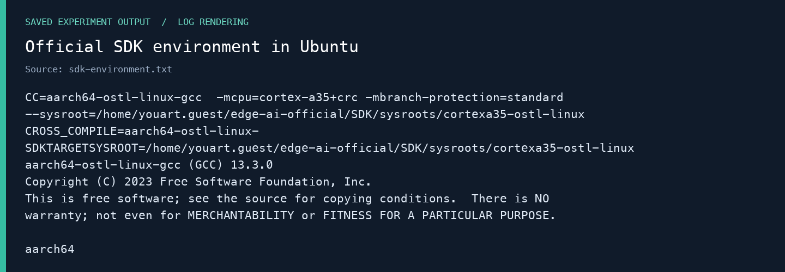
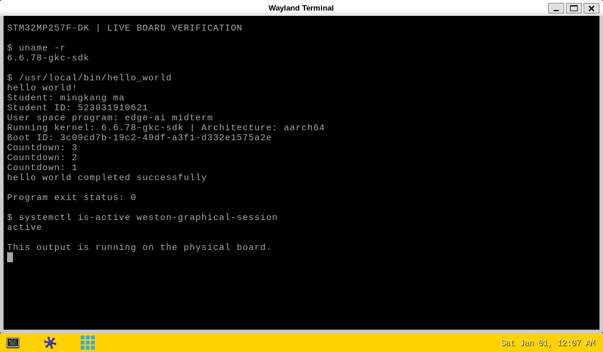
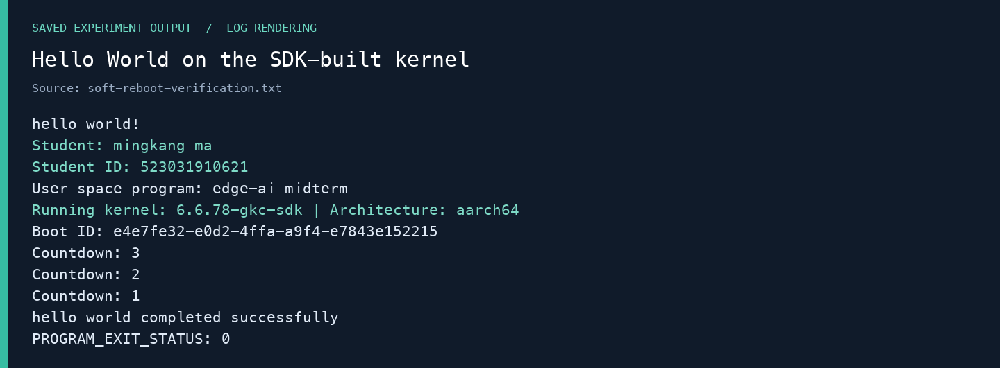
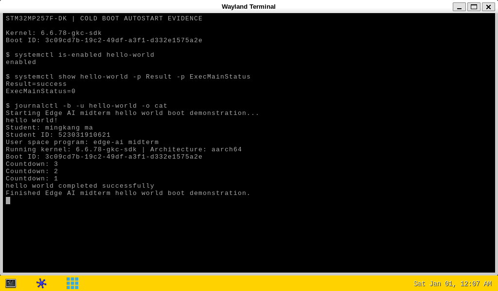
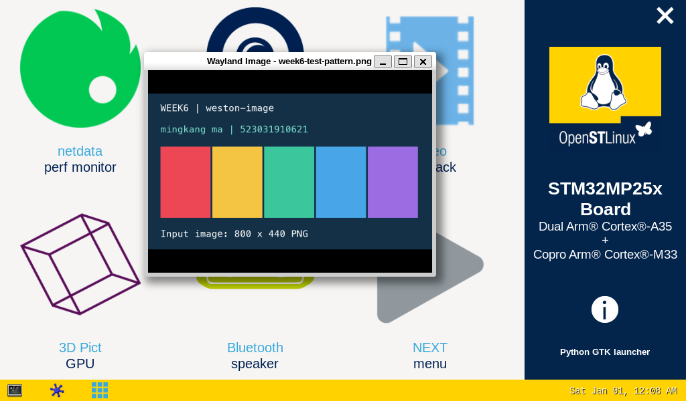
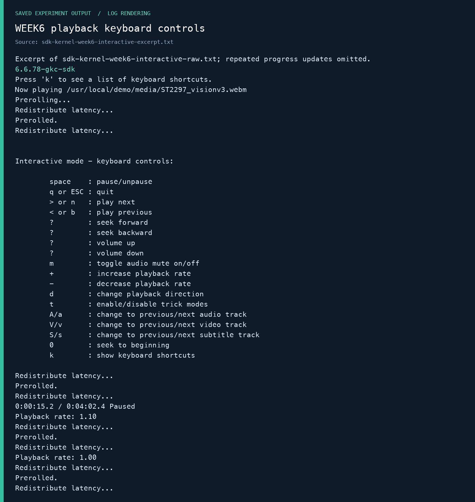
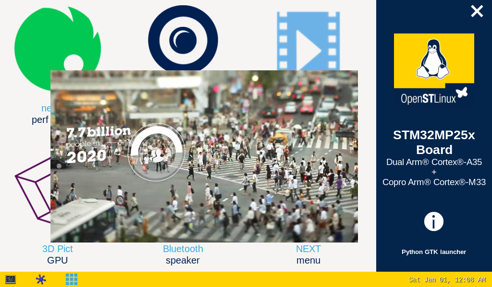

# STM32MP257F-DK 实验全流程：OpenSTLinux SDK 方法

**mingkang ma · 523031910621**  
构建主机：macOS + Ubuntu 24.04 ARM64；同时提供 Windows + Ubuntu x86_64 的复现步骤。

这份手册面向手动操作。每段命令标注执行位置；Linux 与板卡步骤共用，仅在宿主系统不同的地方分开说明。源码、Makefile、部署程序和真实输出随手册提供。Windows 步骤根据官方说明编写，尚未在组员 Windows 电脑上完整实测。

## 1. 实验目标、版本与验收

本次按 WEEK7 的 SDK 初始化、源码准备、ST 配置片段、内核与模块编译、网络部署、用户程序交叉编译流程实施。WEEK6 补充终端、传输、图像、GPU 和视频控制。WEEK8 激光雷达因暂无设备不实施。

**本版验收：官方 SDK 构建的内核、Makefile 与 Hello World、真实断电上电后的自动运行，三项均已通过。** 用户完成物理断电再上电后，先读取本次启动日志，确认服务在开机约 11.42 秒自动执行。

| 检查项 | 必须看到的结果 |
|---|---|
| 自己配置与编译的 Linux 内核 | 板上 `uname -r` 为 `6.6.78-gkc-sdk`，`/proc/version` 含 SDK GCC 13.3.0；运行配置与构建配置一致 |
| Hello World 和 Makefile | 实际编译命令使用 `aarch64-ostl-linux-gcc` 和 SDK sysroot；ELF 为 AArch64；在板上输出姓名学号、退出 0 |
| 上电自动运行 | 实际断电再上电后，当前 Boot ID 的服务日志已有完整输出，服务成功且退出 0；不能以手动启动服务代替 |

旧的 `6.6.78-gkc-midterm` 是 Ubuntu GNU 工具链的历史结果，保留作回退。验收 SDK 流程时，应展示本版 `6.6.78-gkc-sdk` 的证据。

课件页码在本文均指 **PDF 的物理页码**，不是页内印刷编号：WEEK7 第 38–44 页是内核步骤，第 66 页起为用户程序；第 41 页明确允许从 ST 官方 GitHub 获取源码。

## 2. 板卡、屏幕和接线

| 项目 | 实际确认 |
|---|---|
| 开发板 | STM32MP257F-DK，MB1605；STM32MP257FAK3 |
| CPU | 双 Cortex-A35 + Cortex-M33；运行 Linux 的架构为 AArch64 |
| 系统 | OpenSTLinux Weston v25.06.11，Yocto Scarthgap，版本字符串 `5.0.8-openstlinux-6.6-yocto-scarthgap-mpu-v25.06.11` |
| 对应 Developer Package | STM32MP2Dev **6.1.0**；原厂内核 6.6.78 |
| 屏幕 | HDMI，实测 1024×600；完整产品型号尚待屏幕背面标签确认 |
| 触摸 | WaveShare WS170120，USB VID:PID `0eef:0005`，用户已确认触摸正常 |

课件中存在 Cortex-A7/M4、LVDS 和其他版本示例；它们不能直接覆盖这块实物的确认结果。USB 名称 WS170120 也不等于完整屏幕型号。

| 接线 | 作用 |
|---|---|
| CN21 Power/ST-LINK → 宿主电脑或合适的供电设备 | 供电；连电脑时还提供串口 |
| CN15 USB OTG → 宿主电脑，使用数据线 | USB 网络；主机 192.168.7.80，板卡 192.168.7.1 |
| CN1 HDMI → 屏幕 | 视频 |
| 屏幕 USB 触摸线 → 板卡 USB-A 主机接口 | 触摸；屏幕供电按该屏幕标签接好 |

本次不使用 CN2 LVDS。屏幕仅接 HDMI 通常不足以同时满足供电与触摸需求；不要将触摸线插到仅供电的端口。

## 3. 三个执行位置

| 标签 | 打开的终端 | 如何区分 |
|---|---|---|
| 宿主—macOS | Mac“终端” | `uname -s` 是 Darwin |
| 宿主—Windows | PowerShell | 用于串口、SSH、SCP、宿主文件 |
| Linux VM | Ubuntu 虚拟机中的终端 | SDK、源码和编译都在这里；内核名通常含 generic |
| 板卡 | SSH 或 ST-LINK 串口登录 root 后 | 主机名类似 stm32mp2-…；验收内核应为 6.6.78-gkc-sdk |

两台 ARM64 机器能够运行同一个简单 ELF，并不说明程序已在板上通过。验收必须在板卡终端进行。

## 4. WEEK5：检查已有系统

本板已经由用户刷入 Starter 镜像，本次不重刷整张 SD 卡。新内核通过网络部署，保留原厂启动入口、旧内核与现有引导链。

**板卡：**

```sh
uname -a
cat /etc/os-release
cat /proc/device-tree/model
cat /proc/cmdline
df -h / /boot
```

确认 v25.06.11 / 6.6.78 基线，再选配套 SDK 6.1.0。课件文件名里的 v26.02.18 是另一套示例；若组员板上是新版，应让 Starter、SDK、BSP 三者配套，不能只替换其中一个版本。

空卡刷机仍按 WEEK5 的对应 FlashLayout 和 STM32CubeProgrammer 指导执行；当前已完成实验的卡无需重复。本文的部署程序只接受已核对的 6.6.78 基线，不能用于任意型号或发行版。

## 5. 创建 Ubuntu 构建环境：宿主差异

### 5.1 macOS：Apple 芯片 + Lima（本次实测）

把项目文件夹放到 `~/Desktop/gkc`。本次工作目录已包含 `tools/lima`；分享资料包不捆绑虚拟机软件，新电脑先创建 `tools/lima` 目录，从 [Lima 2.2.1 官方发布页](https://github.com/lima-vm/lima/releases/tag/v2.2.1) 下载 Darwin ARM64 包并核对发布方校验值，解压到该目录，使 `tools/lima/bin/limactl` 存在。Intel Mac 应使用对应宿主架构和 x86_64 Ubuntu，不能照搬这里的 ARM64 参数。

**宿主—macOS，仅新建虚拟机执行一次：**

```sh
cd "$HOME/Desktop/gkc"
tools/lima/bin/limactl start --name=edge-ai \
  --vm-type=vz --arch=aarch64 --cpus=6 --memory=6 --disk=60 \
  --containerd=none --mount-only="$PWD:w" \
  --tty=false template:ubuntu-24.04
```

已存在时启动并进入：

```sh
cd "$HOME/Desktop/gkc"
tools/lima/bin/limactl start edge-ai
tools/lima/bin/limactl shell edge-ai
```

**Linux VM：** 设置共享目录变量为实际 Mac 项目路径。本次如下；其他组员替换用户名。

```sh
export PROJECT=/Users/youart/Desktop/gkc
ls "$PROJECT/scripts"
uname -m
```

应看到 `aarch64`。源码、SDK 与编译输出放在虚拟机自己的 Linux 文件系统；共享目录只收发压缩包、脚本和成果。

### 5.2 Windows：Intel/AMD + Ubuntu 虚拟机（复现指南）

推荐安装 Ubuntu 24.04 LTS x86_64 虚拟机。ST 推荐近期 Ubuntu LTS，并给出 Windows 虚拟机方案；[ST 主机要求](https://wiki.st.com/stm32mpu/wiki/PC_prerequisites)。Windows 原生 PowerShell 不能执行 Linux SDK 安装器。

1. 安装 [VirtualBox](https://www.virtualbox.org/) 或已有的虚拟机软件；下载 [Ubuntu 24.04 AMD64 镜像](https://releases.ubuntu.com/24.04/)。
2. 新建 Ubuntu 虚拟机，建议 4–6 核、6–8 GiB 内存、60 GiB 以上磁盘，使用 NAT 联网；在虚拟机磁盘中安装 Ubuntu。
3. 以 VirtualBox 为例，安装与宿主版本配套的 Guest Additions。先在 Ubuntu 执行 `sudo apt-get install build-essential dkms linux-headers-$(uname -r)`，从虚拟机“设备”菜单插入增强功能光盘，运行其 `VBoxLinuxAdditions.run`，重启。
4. 将 Windows 项目放在 `C:\gkc`，在虚拟机共享文件夹设置中添加该目录，名称 `gkc`，勾选自动挂载与固定分配。在 Ubuntu 将自己加入 `vboxsf` 组后注销再登录。

**Linux VM：**

```sh
sudo usermod -aG vboxsf "$USER"
# 注销 Ubuntu 登录会话并重新登录后：
export PROJECT=/media/sf_gkc
ls "$PROJECT/scripts"
uname -m
```

应看到 `x86_64`。共享文件夹的细节见 [VirtualBox Guest Additions 官方说明](https://docs.oracle.com/en/virtualization/virtualbox/7.0/user/guestadditions.html)。没有共享目录时，也可在 Ubuntu 内下载 SDK 和源码，最后通过自己配置的文件传输方式导出成果。

本方案中 **Windows 直接连接板卡的 CN15 与串口**，虚拟机只编译；无需让 Ubuntu 抢占这些 USB 设备。后面从共享目录把成品交给 Windows，再由 PowerShell SCP 到板卡。WSL2 可另作选择，但不作为本文已验证的主路径。

### 5.3 以下 Ubuntu 步骤两种宿主共用

**Linux VM：**

```sh
sudo apt-get update
sudo apt-get install -y \
  build-essential bc bison flex libssl-dev libelf-dev libncurses-dev \
  libyaml-dev u-boot-tools dwarves device-tree-compiler kmod \
  gawk diffstat chrpath socat texinfo python3 python3-pip python3-pexpect \
  git rsync cpio file wget curl xz-utils unzip minicom
mkdir -p "$HOME/edge-ai-official"/{downloads,src,build}
export LAB="$HOME/edge-ai-official"
```

不要把 SDK、Linux 源码与构建目录放进 Windows NTFS／Mac 默认不区分大小写的共享目录。安装宿主依赖与使用 SDK 是两件事；`apt install gcc-aarch64-linux-gnu` 不能代替 SDK。

## 6. 下载、安装并初始化官方 SDK

打开 [STM32MP2 Developer Package](https://www.st.com/en/embedded-software/stm32mp2dev.html#get-software)，选择 **6.1.0**。

| Linux 构建主机 | 下载行 | 目标板 |
|---|---|---|
| Apple 芯片 Mac 的 ARM64 Ubuntu | MP2-DEV-Arm | AArch64 Cortex-A35 |
| 常见 Intel/AMD Windows 的 x86_64 Ubuntu | MP2-DEV-x86 | AArch64 Cortex-A35 |

两种包的差别是“编译器本身在哪种 Linux 主机运行”，不是把板卡改成 x86。阅读并接受自己同意的许可，经账号或邮件验证下载。邮件地址和一次性下载令牌不写进共享手册或脚本。

本次实际 ARM64 包为：

```text
SDK-aarch64-stm32mp2-openstlinux-6.6-yocto-scarthgap-mpu-v25.06.11.tar.gz
```

把自己的包放入项目 `downloads`。**Linux VM：**

```sh
export LAB="$HOME/edge-ai-official"
# 先 ls 确认只有本次所选架构和版本的包；若浏览器加了 en. 前缀，按实际文件名修改。
ls "$PROJECT"/downloads/*SDK*stm32mp2*v25.06.11*.tar.gz
cp "$PROJECT"/downloads/*SDK*stm32mp2*v25.06.11*.tar.gz "$LAB/downloads/"
tar -xf "$LAB"/downloads/*SDK*stm32mp2*v25.06.11*.tar.gz -C "$LAB/downloads"
find "$LAB/downloads" -name '*toolchain*.sh'
```

确认安装器唯一，运行它。下面会安装到 `$LAB/SDK`；不需要 root：

```sh
INSTALLER=$(find "$LAB/downloads" -type f -name '*toolchain*.sh')
printf '%s\n' "$INSTALLER"
bash "$INSTALLER" -y -d "$LAB/SDK"
source "$LAB/SDK/environment-setup-cortexa35-ostl-linux"
printf 'CC=%s\nCROSS_COMPILE=%s\nSYSROOT=%s\n' \
  "$CC" "$CROSS_COMPILE" "$SDKTARGETSYSROOT"
$CC --version
```

本次实际结果：

```text
SDK has been successfully set up and is ready to be used.
CROSS_COMPILE=aarch64-ostl-linux-
aarch64-ostl-linux-gcc (GCC) 13.3.0
```

`CC` 还应包含 `-mcpu=cortex-a35+crc` 与 SDK 中 `sysroots/cortexa35-ostl-linux` 的 `--sysroot` 参数。环境只对当前 shell 生效；每次新开编译终端都重新 `source`。本包没有要求使用一个不存在的裸 `environment-setup` 文件，使用安装器实际提示的完整文件名。



上图由原始日志排版生成，不是终端截图。

原始记录：[安装日志](evidence/sdk-install.log)、[环境与版本](evidence/sdk-environment.txt)、[下载包 SHA-256](evidence/sdk-archive.sha256)。

## 7. 按 WEEK7 准备源码

课件提供三种源码管理方法：官方 BSP 压缩包解压后打补丁、ST 官方 GitHub 已打补丁源码、社区内核加 ST 补丁。它们是可选路径，不能对已包含 ST 补丁的源码再次打同一补丁。

本次构建采用 WEEK7 第 41 页的 **ST 官方 GitHub 路径**，版本与板上 v25.06.11 匹配。官方 SDK 已实际安装并用于内核和用户程序编译，对应内核发行配方明确指定 6.6.78、ST r2。

老师提供的 **FLASH 包可以使用**：它用于 WEEK5 刷入现成系统，也可留作恢复。FLASH 中的成品内核不能替代 WEEK7 要求的源码编译。三类文件作用如下；本次 GitHub 源码路径已完整实施，不必再等待 SOURCES 包。

| 文件／来源 | 内容和用途 | 本次使用 |
|---|---|---|
| FLASH / Starter | 预编译系统、引导固件、文件系统与 FlashLayout，用于刷机 | 用户此前已刷机；新下载包可用于恢复 |
| SDK / MP2-DEV-Arm 或 MP2-DEV-x86 | Linux 主机上的交叉工具链与目标 sysroot | 已安装并实际编译 |
| SOURCES / MP2-DEV-SRC，或课件列出的 ST GitHub | 内核、补丁、配置及相关源码 | 使用配套 ST GitHub 标签／提交；SOURCES 邮件下载曾返回 403 |

### 7.1 本次路径：ST 官方源码标签／提交

**Linux VM：** 如果沿用项目内已经下载、核验的包，直接解压；从头复现则先运行这四条下载命令。

```sh
mkdir -p "$PROJECT/downloads"
cd "$PROJECT/downloads"
curl -fL https://api.github.com/repos/STMicroelectronics/linux/tarball/v6.6-stm32mp-r2 \
  -o linux-v6.6-stm32mp-r2.tar.gz
curl -fL https://api.github.com/repos/STMicroelectronics/meta-st-stm32mp/tarball/openstlinux-6.6-yocto-scarthgap-mpu-v25.06.11 \
  -o meta-st-stm32mp-v25.06.11.tar.gz
curl -fL https://api.github.com/repos/STMicroelectronics/dt-stm32mp/tarball/ea2e971efac93f4644ceede7b997081ed49780ad \
  -o dt-stm32mp-v6-r2.tar.gz
curl -fL https://api.github.com/repos/STMicroelectronics/gcnano-binaries/tarball/7c181cacf89f918039e64934fdc33fe817a052cd \
  -o gcnano-v6.4.21-r1.tar.gz
sha256sum *.tar.gz
```

下载的是官方 GitHub 源码快照，Git 历史管理可选。若需要 Git，课件对应命令为 `git clone` 后 checkout `v6.6-stm32mp-r2`。本文的构建不依赖 `.git`。

```sh
export LAB="$HOME/edge-ai-official"
mkdir -p "$LAB/src"/{linux,meta-st,external-dt,gcnano}
tar -xf "$PROJECT/downloads/linux-v6.6-stm32mp-r2.tar.gz" \
  -C "$LAB/src/linux" --strip-components=1
tar -xf "$PROJECT/downloads/meta-st-stm32mp-v25.06.11.tar.gz" \
  -C "$LAB/src/meta-st" --strip-components=1
tar -xf "$PROJECT/downloads/dt-stm32mp-v6-r2.tar.gz" \
  -C "$LAB/src/external-dt" --strip-components=1
tar -xf "$PROJECT/downloads/gcnano-v6.4.21-r1.tar.gz" \
  -C "$LAB/src/gcnano" --strip-components=1
```

上面只在空目录第一次执行。该版本外部设备树路径为 `src/external-dt/stm32mp2/a35-td/linux`；gcnano 模块源码在 `src/gcnano/gcnano-driver-stm32mp`。

### 7.2 若使用成功下载的官方 BSP 包

解压 `SOURCES-stm32mp-openstlinux-6.6-yocto-scarthgap-mpu-v25.06.11.tar.gz`，打开其中 `linux-stm32mp-6.6.78-…/README.HOW_TO.txt.stm32mp2`、external-dt 与 gcnano 的同名说明。按 README 解压原始内核并依次应用 `series`／`*.patch`，再应用 `fragment*.config`。这条路径不要再套用 7.1 的已打补丁源码。

第三份 PDF 展示了较新版的目录名和 `stm32mp2-m33td`，本板是 A35-TD；选择 `stm32mp2` 说明。内核实际用到外部设备树；本次不重新制作 TF-A、OP-TEE、U-Boot、DDR 固件或整套 Starter 镜像。

## 8. 配置与编译内核、模块和设备树

**Linux VM，保持 SDK 已 source：**

```sh
source "$LAB/SDK/environment-setup-cortexa35-ostl-linux"
export OUTPUT_BUILD_DIR="$LAB/build/kernel"
export EXTDT_DIR="$LAB/src/external-dt/stm32mp2/a35-td"
mkdir -p "$OUTPUT_BUILD_DIR"
cd "$LAB/src/linux"
make O="$OUTPUT_BUILD_DIR" defconfig
scripts/kconfig/merge_config.sh -m -r -O "$OUTPUT_BUILD_DIR" \
  "$OUTPUT_BUILD_DIR/.config" \
  arch/arm64/configs/fragment-01-defconfig-cleanup.config \
  arch/arm64/configs/fragment-02-defconfig-addons.config \
  "$LAB/src/meta-st/recipes-kernel/linux/linux-stm32mp/6.6/fragment-03-systemd.config" \
  "$LAB/src/meta-st/recipes-kernel/linux/linux-stm32mp/6.6/fragment-04-modules.config"
scripts/config --file "$OUTPUT_BUILD_DIR/.config" \
  --set-str LOCALVERSION '-gkc-sdk' --disable LOCALVERSION_AUTO
make O="$OUTPUT_BUILD_DIR" olddefconfig
make -j6 O="$OUTPUT_BUILD_DIR" Image.gz vmlinux modules dtbs \
  KBUILD_EXTDTS="$EXTDT_DIR/linux"
make O="$OUTPUT_BUILD_DIR" INSTALL_MOD_PATH="$OUTPUT_BUILD_DIR/install_artifact" \
  INSTALL_MOD_STRIP=1 modules_install
mkdir -p "$OUTPUT_BUILD_DIR/install_artifact/boot"
cp "$OUTPUT_BUILD_DIR/arch/arm64/boot/Image.gz" "$OUTPUT_BUILD_DIR/install_artifact/boot/"
find "$OUTPUT_BUILD_DIR/arch/arm64/boot/dts" -name 'stm32mp257f-dk*.dtb' \
  -exec cp {} "$OUTPUT_BUILD_DIR/install_artifact/boot/" \;
cp "$OUTPUT_BUILD_DIR/.config" "$OUTPUT_BUILD_DIR/install_artifact/boot/config-gkc-sdk"
make -s O="$OUTPUT_BUILD_DIR" kernelrelease
```

预期最后一行为 `6.6.78-gkc-sdk`。本次重新编译的三份 STM32MP257F-DK 设备树与原厂对应文件逐字节相同，证明所选设备树基线配套；详见 [设备树与配置对照](evidence/config-dtb-comparison.txt)。`LOCALVERSION` 是实际编译配置的一部分，可让老师核对自编译结果。内核是 ARM64，使用 `Image.gz`；不要照抄 32 位例子的 `uImage`。

这组命令也保存为 `scripts/build-sdk-kernel.sh`，可从 Ubuntu 执行：

```sh
bash "$PROJECT/scripts/build-sdk-kernel.sh" 2>&1 | tee "$LAB/kernel-sdk-build.log"
```

选择手动命令或脚本一种即可。脚本自己初始化 SDK，检查 `aarch64-ostl-linux-`，不会切换回 Ubuntu GNU 交叉编译器。

### 8.1 重编译 gcnano 图形模块

更换内核版本后，需要为它编译匹配的 `galcore.ko`，否则桌面可能因 GPU 模块版本不匹配失败。

```sh
source "$LAB/SDK/environment-setup-cortexa35-ostl-linux"
GPU_SRC="$LAB/src/gcnano/gcnano-driver-stm32mp"
make -j6 -C "$OUTPUT_BUILD_DIR" M="$GPU_SRC" AQROOT="$GPU_SRC" \
  SOC_PLATFORM=st-mp2 DEBUG=0 modules
make -C "$OUTPUT_BUILD_DIR" M="$GPU_SRC" AQROOT="$GPU_SRC" \
  SOC_PLATFORM=st-mp2 DEBUG=0 \
  INSTALL_MOD_PATH="$OUTPUT_BUILD_DIR/install_artifact" INSTALL_MOD_STRIP=1 modules_install
```

对应脚本是 `scripts/build-sdk-gpu.sh`。所有模块必须与部署的内核同一次配置、同一版本；不能把旧 `galcore.ko` 改个目录名就当作新模块。

## 9. Hello World 源码与 Makefile

源码见 [hello_world.c](code/hello_world/hello_world.c)。其他组员复现时，先在该文件中改为自己的姓名和学号，再重新编译。程序输出 `hello world!`、姓名 `mingkang ma`、学号 `523031910621`、运行内核、架构、Boot ID 和三秒倒计时，成功退出 0。

随包 `scripts/verify-board.sh` 也默认检查本次姓名与学号；改名后，同时修改其中两处 `Student:`／`Student ID:` 检查字符串，再打包。仅修改身份文本不需要重新编译内核。

**Linux VM：**

```sh
source "$LAB/SDK/environment-setup-cortexa35-ostl-linux"
mkdir -p "$LAB/hello_world"
cp "$PROJECT/hello_world/hello_world.c" "$PROJECT/hello_world/Makefile" "$LAB/hello_world/"
cd "$LAB/hello_world"
make clean
make
file hello_world
$READELF -h hello_world
$READELF -p .comment hello_world
make install
```

本次构建日志显示：SDK GCC 13.3.0、`-mcpu=cortex-a35+crc`、配套 `--sysroot`，生成 `ELF 64-bit … ARM aarch64`。`file` 中 “for GNU/Linux 5.15.0” 是该 ELF 的最低 ABI 标记，不是说板卡正在运行 5.15 内核。

Makefile 接收 SDK 环境变量中的 `CC`、`CFLAGS`、`LDFLAGS`，不会把完整 `CC` 字符串加引号当成一个可执行文件名。recipe 的行首必须是 **Tab**。直接使用提供的文件最稳妥。

```makefile
.DEFAULT_GOAL := all
ifeq ($(origin CC),default)
$(error Load the OpenSTLinux SDK environment before running make)
endif
CFLAGS ?= -O2 -g -Wall -Wextra -Werror
PROG := hello_world
OBJS := hello_world.o
DESTDIR ?= $(CURDIR)/install_artifact
PREFIX ?= /usr/local
.PHONY: all clean install
all: $(PROG)
$(PROG): $(OBJS)
	$(CC) $(LDFLAGS) -o $@ $(OBJS) $(LDLIBS)
%.o: %.c
	$(CC) $(CPPFLAGS) $(CFLAGS) -c $< -o $@
install: $(PROG)
	install -d $(DESTDIR)$(PREFIX)/bin
	install -m 0755 $(PROG) $(DESTDIR)$(PREFIX)/bin/$(PROG)
clean:
	rm -f $(PROG) $(OBJS)
```

Makefile 在没有加载编译环境时会明确报错，防止不小心用宿主默认编译器生成错误结果。**必须先 source SDK**，并核对实际命令前缀为 `aarch64-ostl-linux-gcc`。

原始记录：[SDK Makefile 编译结果](evidence/hello-sdk-build-final.txt)。从头重新编译时，文件哈希可能因构建时间、主机路径等发生变化；应比较自己构建、传输和板上安装的同一份文件，不要求复现本手册成品的固定哈希。

## 10. 串口、USB 网络、SSH：宿主差异

### 10.1 macOS

若需要现场保存终端过程，macOS 可在 SSH 前运行 `script -q board-session.txt`，结束后输入 `exit`；Windows PowerShell 可用 `Start-Transcript -Path board-session.txt` 与 `Stop-Transcript`。Tera Term 也可通过 File → Log 保存串口会话。

**宿主—macOS：**

```sh
ls /dev/cu.usbmodem*
screen /dev/cu.usbmodem102 115200
```

串口设备名以本机枚举为准。设置 115200、8N1、无流控；按 Enter，必要时以 `root` 登录。退出 screen：Ctrl+A，再按 K，确认。本机另有 `scripts/board-terminal.command` 可双击进入串口；其他电脑按上面的设备枚举结果连接。

接好 CN15 数据线后，网络设置中应出现 USB 网络，IPv4 使用 DHCP。本次 Mac 得到 192.168.7.80。验证：

```sh
ping -c 3 192.168.7.1
ssh root@192.168.7.1
```

### 10.2 Windows

安装 [Tera Term](https://teratermproject.github.io/) 或使用已有串口工具；设备管理器找到 ST-LINK Virtual COM Port，选择相应 COM 端口，115200、8N1、无流控。若无法枚举，安装 [ST 官方 ST-LINK USB 驱动](https://www.st.com/en/development-tools/stsw-link009.html)。

CN15 连接 Windows 后，会出现 USB/RNDIS 以太网接口。本次之前的 Windows 枚举已看到 192.168.7.80/24；现在实验使用 Mac 直连，**不再需要 Windows 中转或端口转发**。

**宿主—Windows PowerShell：**

```powershell
Get-NetIPAddress -AddressFamily IPv4 | Select-Object InterfaceAlias,IPAddress,PrefixLength
Test-NetConnection 192.168.7.1 -Port 22
ssh root@192.168.7.1
```

Windows 10/11 若没有 `ssh`／`scp`，在“可选功能”安装 OpenSSH Client。虚拟机无需访问 192.168.7.1；由宿主直接传输。

### 10.3 登录后的共用检查

SSH 首次连接时，通过串口读取板卡主机密钥指纹，与提示核对再接受；使用本项目的 `tools/board_ssh_config` 时密钥已固定为本次实物。其他板卡不要直接沿用这份 known_hosts。

**板卡：**

```sh
hostname
uname -r
ip -4 addr show usb0
cat /etc/os-release
```

`root` 密码按 Starter 配置填写，本次为空。SCP 使用大写 `-O` 选择传统 SCP，因为板上 Dropbear 默认没有 SFTP 服务。

## 11. 打包、部署与重启

**Linux VM：** 在第 8、9 节完成后执行：

```sh
PROJECT_ROOT="$PROJECT" bash "$PROJECT/scripts/package-sdk.sh"
```

本次产物为约 24 MiB，SHA-256：`122d942e37545d64fd199c3aa37e0dbc48345fd1c2299631a2bca5fcbf322c34`。

它重新构建 Hello World，归集新内核、模块、DTB、配置、服务，移除指向构建主机的模块开发链接，生成文件校验清单和 `delivery/gkc-sdk-6.6.78.tar.gz`。不要在已存在的同名打包目录上重复执行；若要重打包，先将旧 `$LAB/package/gkc-sdk` 改名保存。

**宿主—macOS：**

```sh
cd "$HOME/Desktop/gkc"
shasum -a 256 delivery/gkc-sdk-6.6.78.tar.gz
scp -O delivery/gkc-sdk-6.6.78.tar.gz root@192.168.7.1:/home/root/
ssh root@192.168.7.1
```

**宿主—Windows PowerShell：**

```powershell
cd C:\gkc
Get-FileHash .\delivery\gkc-sdk-6.6.78.tar.gz -Algorithm SHA256
scp -O .\delivery\gkc-sdk-6.6.78.tar.gz root@192.168.7.1:/home/root/
ssh root@192.168.7.1
```

**板卡：**

```sh
cd /home/root
sha256sum gkc-sdk-6.6.78.tar.gz
tar -xzf gkc-sdk-6.6.78.tar.gz 2> gkc-sdk-extract.log
python3 gkc-sdk/scripts/deploy-sdk-board.py /home/root/gkc-sdk
```

板卡 RTC 若停在 2000 年，解压日志可能出现“time stamp … in the future”；这是时钟差异，不等于包损坏。继续核对部署程序的全部校验值及返回状态。

先检查上面输出的计划：板型、现有版本、可用空间、包校验值、新启动项。确认符合本板后执行写入：

```sh
python3 gkc-sdk/scripts/deploy-sdk-board.py /home/root/gkc-sdk --apply
sync
reboot
```

脚本对部署进行具体保护：旧 `Image.gz`、旧 `gkc-midterm` 入口不覆盖；新内核为 `/boot/Image-6.6.78-gkc-sdk.gz`，新 DTB 在 `/boot/gkc-sdk/`，模块在 `/lib/modules/6.6.78-gkc-sdk/`；克隆本机 extlinux 的根分区参数，新入口使用 `FDTDIR /gkc-sdk/`。全部文件写入并同步后才切换默认启动项。

它同时安装 `/usr/local/bin/hello_world` 和 `/etc/systemd/system/hello-world.service`。不要照搬其他同学的 PARTUUID；脚本从当前运行系统与实际配置中匹配。脚本仅适用于本手册检查过的板型／基线，第二次运行会拒绝覆盖已存在的新部署，应先检查状态。

### 11.1 理解课件的手动部署步骤

本次实际使用上面的检查式部署程序完成写入。若希望理解每一步，下面是它执行的核心文件操作，与 WEEK7 的网络部署对应。**这是一条替代操作路径，不要在脚本部署完成后再重复执行。** 先检查包的 SHA256SUMS、板型、版本和空间，并备份启动配置、原用户程序与服务。

**板卡，在已解压的包目录中：**

```sh
cd /home/root/gkc-sdk
sha256sum -c SHA256SUMS
uname -r
df -h /boot /
BACKUP=/home/root/before-sdk-manual
mkdir "$BACKUP"
cp /boot/mmc0_extlinux/extlinux.conf "$BACKUP/"
# 如已有 hello_world 和 hello-world.service，先各自复制到 BACKUP。
cp kernel/boot/Image.gz /boot/Image-6.6.78-gkc-sdk.gz
mkdir /boot/gkc-sdk
cp kernel/boot/stm32mp257f-dk*.dtb /boot/gkc-sdk/
cp -a kernel/lib/modules/6.6.78-gkc-sdk /lib/modules/
depmod 6.6.78-gkc-sdk
install -m 0755 hello_world/install_artifact/usr/local/bin/hello_world /usr/local/bin/hello_world
install -m 0644 systemd/hello-world.service /etc/systemd/system/hello-world.service
systemctl daemon-reload
systemctl enable hello-world.service
```

接着编辑 `/boot/mmc0_extlinux/extlinux.conf`：复制原 `LABEL OpenSTLinux` 整个段落，给副本改名 `LABEL gkc-sdk`，将 KERNEL 改为 `/Image-6.6.78-gkc-sdk.gz`，FDTDIR 改为 `/gkc-sdk/`，保持 INITRD 与 APPEND 完全一致，再设置 `DEFAULT gkc-sdk`。保留原入口与原文件。保存后执行 `sync`、`reboot`，进入第 12 节检查。

这也解释了为什么仅复制一个 Image.gz 不够：驱动模块、设备树、启动选择和用户空间服务需要相互对应。推荐直接执行前面的部署程序，因为它还会检查校验值、模块版本、根分区和回退条件。

## 12. 设置上电自动运行与三项验证

systemd 服务内容如下，源文件见 [hello-world.service](code/systemd/hello-world.service)：

```ini
[Unit]
Description=Edge AI midterm hello world boot demonstration
After=local-fs.target

[Service]
Type=oneshot
ExecStart=/usr/local/bin/hello_world
RemainAfterExit=yes
StandardOutput=journal+console
StandardError=journal+console

[Install]
WantedBy=multi-user.target
```

若手动安装服务，在板上执行 `systemctl daemon-reload`、`systemctl enable hello-world.service`。部署程序已完成这两步。`enable` 将服务接入启动目标；`start` 只运行一次，两者不同。

### 12.1 先验证软件重启

重新 SSH 连接，先读取本次启动日志，再手动运行程序：

```sh
uname -r
cat /proc/version
cat /proc/sys/kernel/random/boot_id
systemctl is-enabled hello-world.service
systemctl show hello-world.service -p Result -p ExecMainStatus -p ExecMainStartTimestampMonotonic
journalctl -b -u hello-world.service --no-pager -o cat
/usr/local/bin/hello_world
printf 'exit=%s\n' "$?"
modinfo galcore | head
systemctl is-active weston-graphical-session
systemctl --failed --no-pager
```

看到 `6.6.78-gkc-sdk`、SDK 编译器标记、姓名学号、`Result=success`、`ExecMainStatus=0`。服务是 oneshot，显示 `active (exited)` 正常。`ExecMainStartTimestampMonotonic` 单位微秒，例如 11000000 表示本次开机约 11 秒启动。

提供的整体验证程序可运行：

```sh
sh /home/root/gkc-sdk/scripts/verify-board.sh
```

本次软件重启实际结果：Boot ID 为 `e4e7fe32-e0d2-4ffa-a9f4-e7843e152215`，服务在本次开机 10.474155 秒启动，`Result=success`、`ExecMainStatus=0`，桌面 active，系统失败单元数为 0。运行配置与构建配置逐字节相同，SHA-256 为 `445ede30359592b0ea4f366caf1ed748d07e1d595a9980a1b3c5bd506d767833`。



上图在后续冷启动验收完成后采集，来自板卡真实 Weston 终端。手动运行用于验证程序本身；自动运行证据单独见下一节。



此图来自真实日志排版，不是终端原始截图。原始记录：[软件重启验收](evidence/soft-reboot-verification.txt)、[先读取的自启日志](evidence/soft-reboot-autostart.txt)。

### 12.2 再验证真实断电上电

1. 记录旧 Boot ID，执行 `poweroff`，等待安全关机。
2. 断开所有可能给板卡供电的线，至少包括本次 CN21 与 CN15，确认板卡电源灯熄灭；等约 5 秒再恢复原接线。
3. 等系统启动、USB 网络恢复后，重新 SSH 连接。
4. **先读取** Boot ID、`systemctl show` 和 `journalctl -b -u hello-world`，不要先运行 `systemctl start/restart hello-world`。
5. 新 Boot ID 不同，并且当前日志已经有 `6.6.78-gkc-sdk`、姓名、学号和完成行，服务成功退出，才证明这一轮上电自动运行。

**本次实际冷启动已通过。** 用户确认完成断电上电后，主机于 2026-10-25 21:32:55（UTC+8）保存第一次只读检查记录。新 Boot ID 为 `3c09cd7b-19c2-49df-a3f1-d332e1575a2e`，与软件重启那次不同；服务在开机 11.416478 秒启动。读取时尚未手动启动或重启该服务。

```text
Kernel: 6.6.78-gkc-sdk
Boot ID: 3c09cd7b-19c2-49df-a3f1-d332e1575a2e
enabled
Result=success
ExecMainStartTimestampMonotonic=11416478
ExecMainStatus=0
hello world!
Student: mingkang ma
Student ID: 523031910621
hello world completed successfully
```

这是原始输出的节选。完整记录：[首次读取的冷启动自启日志](evidence/cold-boot-autostart.txt)、[后续程序与桌面检查](evidence/cold-boot-verification.txt)、[模块和文件校验](evidence/cold-boot-hardware.txt)。冷启动后运行配置仍与构建配置相同，GPU 模块版本匹配，HDMI 为 1024×600，失败单元数为 0。



上图是板卡终端显示当前启动日志的真实截图；显示这些日志不会重新启动 Hello World 服务。

这里“用户程序随上电启动”的机制是：内核启动 Linux → systemd 启动用户空间服务 → 运行 ELF。无需把 Hello World 写成内核模块或把打印语句塞进内核源码。

板卡 RTC 在断电后可能回到 2000 年，验收以主机记录时间、Boot ID 和开机单调时间对应证据，不能仅凭日历日期判断是否新启动。

## 13. WEEK6：手动复现终端控制与图形演示

### 13.1 远程终端与文件往返

SSH 登录方式见第 10 节。先在宿主新建 `week6-transfer.txt`，写入自己的姓名学号。

**两种宿主的终端都可用：**

```sh
scp -O week6-transfer.txt root@192.168.7.1:/home/root/
ssh root@192.168.7.1 'cat /home/root/week6-transfer.txt; sha256sum /home/root/week6-transfer.txt'
scp -O root@192.168.7.1:/home/root/week6-transfer.txt week6-returned.txt
```

macOS 用 `shasum -a 256 week6-transfer.txt week6-returned.txt`；Windows 用 `Get-FileHash week6-transfer.txt,week6-returned.txt`。本次往返文件内容与校验值一致，见 [文件传输记录](evidence/week6-file-transfer.txt)。这覆盖 WEEK6 第 15–18 页的网络传输；未将未插入的 USB U 盘写为已验证。

### 13.2 停止、启动和重启 Weston 桌面

**板卡（保持 SSH／串口连接）：**

```sh
systemctl stop weston-graphical-session
systemctl is-active weston-graphical-session
systemctl start weston-graphical-session
systemctl is-active weston-graphical-session
systemctl restart weston-graphical-session
```

停止时显示器桌面消失、状态为 inactive；启动后返回 active。`systemctl is-active` 对 inactive 返回非零，这是预期结果。SSH 不依赖桌面，可继续控制。对应 WEEK6 第 27 页。

### 13.3 用 weston-image 显示图片

把随包 `assets/week6-test-pattern.png` 通过 SCP 放到 `/home/root/`。**板卡：**

```sh
export XDG_RUNTIME_DIR=/run/user/1000
export WAYLAND_DISPLAY=wayland-0
weston-image /home/root/week6-test-pattern.png
```

`Ctrl+C` 结束；或屏幕点击窗口关闭。该环境路径适用于本机 UID 1000 的 Weston；若镜像不同，先核对 Weston 运行用户。



图片素材是本项目生成的输入测试图；上图是该素材在物理板卡 Weston 中显示后的真实截图，二者区别明确。

### 13.4 GPU 三角形与图形终端

```sh
export XDG_RUNTIME_DIR=/run/user/1000 WAYLAND_DISPLAY=wayland-0
weston-simple-egl -f
# Ctrl+C 结束后，可继续打开图形终端：
weston-terminal
```

本节图像、GPU 与视频截图已在新内核 `6.6.78-gkc-sdk` 上重新采集，见 [新内核 WEEK6 操作记录](evidence/sdk-kernel-week6-demo.txt)。早先旧内核的记录另行保留，不用于替代 SDK 内核验收。

本次新内核 GPU 输出 `304 frames in 5 seconds: 60.799999 fps`，属于一次短时演示结果，原文见 [GPU 日志](evidence/sdk-kernel-week6-egl.log)。


### 13.5 视频及键盘控制

通过有交互终端的 SSH 或串口运行。**板卡：**

```sh
gst-play-1.0 --help
su -s /bin/sh weston -c 'XDG_RUNTIME_DIR=/run/user/1000 WAYLAND_DISPLAY=wayland-0 gst-play-1.0 /usr/local/demo/media/ST2297_visionv3.webm --audiosink="fakesink sync=true"'
```

`fakesink` 丢弃音频输出，与课件的“仅视频播放”一致；补充 `sync=true` 让音频时钟按正常速率推进。本次未验证扬声器音频。

| 按键 | 操作 | 本次实际观察 |
|---|---|---|
| k | 列出快捷键 | 显示 Interactive mode - keyboard controls |
| 空格 | 暂停／继续 | 播放位置停在 0:00:15.2，并显示 Paused；再次按下继续 |
| + | 加速 | Playback rate: 1.10 |
| - | 减速 | Playback rate: 1.00 |
| q | 退出 | 播放器正常退出 |

以上按键也已在 SDK 新内核上逐个测试，播放器正常退出，主机记录退出码 0。按键逐个按，不要一次粘贴多个字符。真实原始记录：[交互播放日志](evidence/sdk-kernel-week6-interactive-raw.txt)。



上图由交互日志排版，省略重复的进度刷新行；原始日志仍完整保留。



上图来自另一次 `--no-interactive` 视频播放演示；键盘控制证据来自上面单独保存的交互日志。后台播放时可使用 `--no-interactive &`，记下 `$!`，通过 `kill "$PID"` 停止自己启动的进程。不要无差别结束桌面所有播放器。

### 13.6 截图并传回主机

WEEK6 第 33–34 页使用 `weston-screenshooter`。本镜像默认关闭所需调试接口；本次演示临时给 Weston 添加 `--debug`，截图完成后恢复 `/etc/default/weston` 原文件并重启桌面。脚本 `scripts/week6-board-demo.sh` 保存原配置并通过退出清理恢复它。

如果手动操作，先备份 `/etc/default/weston`，保留原有 `OPTARGS` 并追加 `--debug`，重启 `weston-graphical-session`。然后在板上运行：

```sh
CAPTURE_DIR=$(mktemp -d /home/weston/manual-capture.XXXXXX)
chown weston:weston "$CAPTURE_DIR"
su -s /bin/sh weston -c "cd '$CAPTURE_DIR'; XDG_RUNTIME_DIR=/run/user/1000 WAYLAND_DISPLAY=wayland-0 weston-screenshooter"
ls "$CAPTURE_DIR"/*.png
```

每次使用新目录，避免板卡 RTC 复位后按时间排序误选旧截图。用 SCP 从宿主取回该目录中的 PNG；最后恢复原配置、重启 Weston 并确认 active。本手册所有“板卡真实截图”都来自板上 compositor 输出；它们不是相机照片，无法单独证明触摸手势，触摸正常是用户实际操作的确认。

## 14. 验收展示顺序与证据位置

建议展示顺序：先展示 SDK 环境与 Makefile 编译记录 → 通过宿主 SSH 登录板卡 → `uname -r`、`/proc/version` → 手动运行 Hello World → 当前启动的自启日志 → WEEK6 图片、GPU 或视频控制。

实际断电上电验证应提前做一次，现场可再次演示。读取自启日志前不要手动重启该服务，避免混淆证据。

| 证据 | 用途 |
|---|---|
| sdk-install.log、sdk-environment.txt | 官方 SDK 安装成功、环境初始化 |
| kernel-sdk-build.log、gpu-sdk-build.log | 内核、模块与 GPU 驱动实际构建 |
| hello-sdk-build-final.txt | 最终 Makefile 使用 SDK 编译、ELF 架构 |
| kernel-deploy.txt、soft-reboot-verification.txt、soft-reboot-autostart.txt | 部署及软件重启验证 |
| cold-boot-autostart.txt、cold-boot-verification.txt、cold-boot-hardware.txt | 本次真实断电上电自启、程序与硬件验证 |
| sdk-kernel-week6-*.txt / *.log | 新 SDK 内核的 WEEK6 实操及桌面恢复记录 |
| week6-*.txt、egl.log、video.log | 早先基线的 WEEK6 操作记录，供对照 |
| images/*.png | 实际板卡屏幕截图；日志排版图会单独标注 |

未实施：激光雷达、USB U 盘、HTTP 流媒体、扬声器音频、重新刷写完整引导链。不要在实验报告中把这些列为成功结果。

## 15. 常见问题与回退

| 现象 | 检查与处理 |
|---|---|
| Mac/Windows 无法运行 SDK 安装器 | 它是 Linux 安装器；进入 Ubuntu VM，再核对 `uname -m` 与宿主 SDK 包架构 |
| 编译命令仍用 aarch64-linux-gnu-gcc | 新 shell 中未 source SDK，或手动覆盖了 CC/CROSS_COMPILE；检查后重新 clean 构建 |
| `missing separator` | Makefile 命令行没有使用 Tab；使用随包原始文件 |
| `scp: … sftp-server: not found` | 改用 `scp -O` |
| SSH 不通 | 保留串口，检查 CN15 数据线、USB 网卡 IPv4；连接同一 Wi-Fi 本身不等于板子已联网 |
| 屏幕黑、触摸不能用 | 区分 HDMI、屏幕供电、USB 触摸三条路径；`cat /sys/class/drm/card0-HDMI-A-1/modes`；检查 Weston 与 galcore |
| 新内核上 GPU 模块加载失败 | 重编译匹配版本的 galcore，运行 depmod；不要复制旧版本模块充数 |
| services 为 active (exited) | oneshot + RemainAfterExit 的预期状态，配合 Result=success 和退出值判断 |
| BSP 下载 403 | 保存错误记录；可重试自己的官方邮件／账号，或用课件列出的 ST GitHub 路径；不要混入不同发布版源码 |

部署时输出备份目录 `/home/root/gkc-sdk-backup-…`。本次实际目录为 `/home/root/gkc-sdk-backup-946687754379430375`。其中 `extlinux.conf` 保存部署前的启动配置，`rollback.sh` 可恢复默认启动项；同时保留了旧 Hello World 和服务文件。需要完整回退时，在串口中选旧启动项进入系统，再按备份恢复配置与这两个用户空间文件，执行 daemon-reload、sync、reboot。

若新内核无法启动，可通过串口在 U-Boot 的 extlinux 菜单选择 `gkc-midterm` 或 `OpenSTLinux`。保持原厂 Image.gz、DTB 与原入口完整比直接覆盖它们更容易恢复。

## 16. 参考与复现边界

- 课程：WEEK5 系统安装、WEEK6 平台应用、WEEK7 交叉编译 Linux 内核及应用；文件位于项目 `PPT`。
- [ST Developer Package 下载](https://www.st.com/en/embedded-software/stm32mp2dev.html#get-software)
- [ST Linux v6.6-stm32mp-r2](https://github.com/STMicroelectronics/linux/tree/v6.6-stm32mp-r2)
- [配套 v25.06.11 发行配方与 README 模板](https://github.com/STMicroelectronics/meta-st-stm32mp/tree/openstlinux-6.6-yocto-scarthgap-mpu-v25.06.11)
- [ST 主机环境要求](https://wiki.st.com/stm32mpu/wiki/PC_prerequisites)
- [Weston 截图说明](https://wiki.st.com/stm32mpu/wiki/How_to_make_a_screen_capture_in_Weston)

本次实测的是 Apple 芯片 Mac + ARM64 Ubuntu + ARM64 宿主 SDK。Windows 小节提供相同 Linux 流程的宿主迁移方法；需由组员在实际电脑上核对驱动、共享目录、COM 端口与 SDK 主机架构。
